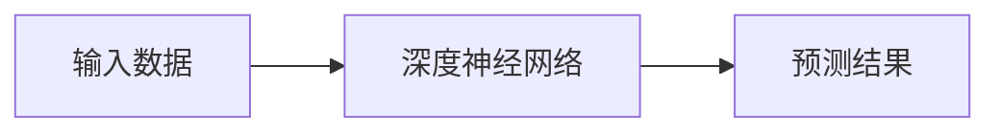
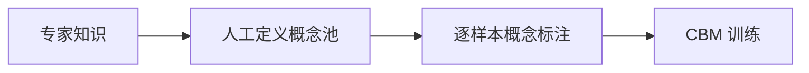
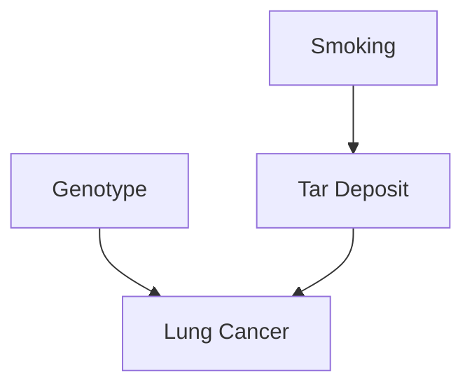
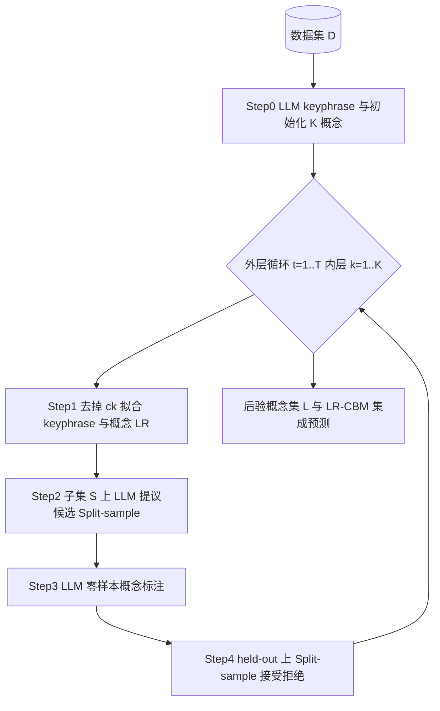
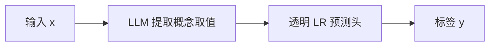
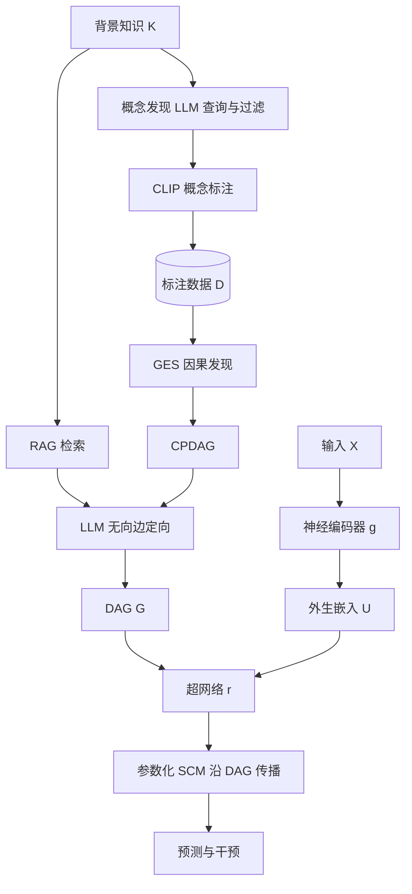
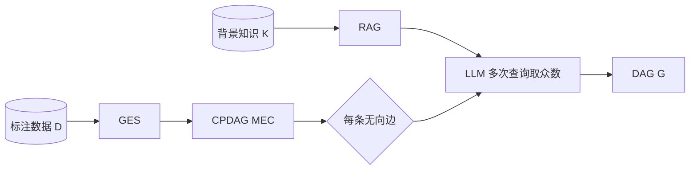
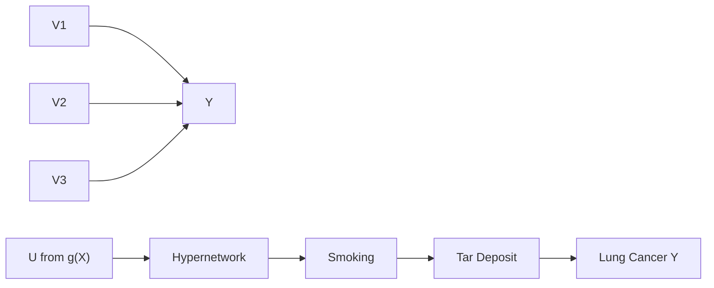
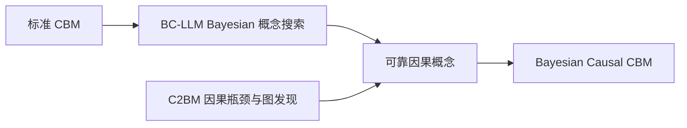
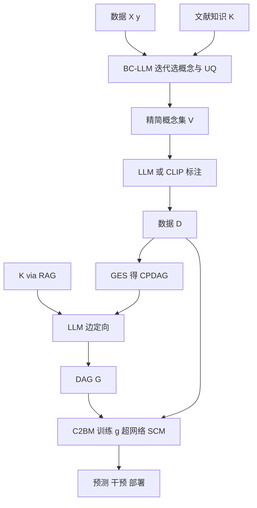

# 基于大语言模型与因果推理的 Concept Bottleneck Model 研究调研与后续规划

------------------------------------------------------------------------

# 0. 报告目标

本报告围绕两篇近期 Concept Bottleneck Model（CBM）方向论文展开：

1.  Bayesian Concept Bottleneck Models with LLM Priors（BC-LLM）
2.  Causally Reliable Concept Bottleneck Models（C²BM）

主要目标：

-   理解两篇论文解决的核心科学问题；
-   梳理完整科研流程，包括问题提出、方法设计、实验验证；
-   分析两篇论文之间的联系和不足；
-   探索结合 LLM、Bayesian 推理以及因果建模的潜在研究方向。

------------------------------------------------------------------------

# 1. 研究背景

## 1.1 黑盒深度学习模型问题

传统深度学习：

优势：

-   强大的预测能力；
-   良好的任务性能。

不足：

-   缺少解释能力；
-   难以进行人工干预；
-   容易学习数据中的虚假相关。

因此，在医疗、科学发现、高风险决策领域，需要：

-   可解释；
-   可验证；
-   可干预；
-   具有因果可靠性的模型。

------------------------------------------------------------------------

# 2. Concept Bottleneck Model 基础

## 2.1 CBM思想

Concept Bottleneck Model 将模型推理过程拆分：

数学形式：

\[ P(Y,V\|X)=P(Y\|V)P(V\|X) \]

其中：

-   X：输入数据
-   V：人类可理解概念
-   Y：预测任务

------------------------------------------------------------------------

## 2.2 CBM优势

相比黑盒模型：

CBM允许：

1.  查看模型依据的概念；
2.  修改概念进行人工干预；
3.  分析模型错误来源。

------------------------------------------------------------------------

# 3. 当前CBM存在的问题

## 3.1 概念发现问题

传统流程：

问题：

-   依赖专家；
-   成本高；
-   难以扩展；
-   可能遗漏关键概念。

对应论文：

# BC-LLM

------------------------------------------------------------------------

## 3.2 因果可靠性问题

传统CBM：

\[ Y=f(V_1,V_2,...,V_C) \]

假设：

所有概念直接影响预测。

但是现实（以 C²BM 论文中的肺癌机制为例）：

概念之间具有层级因果关系；目标变量往往由部分概念经中间机制间接决定，而非所有概念均为 Y 的直接原因。

对应论文：

# C²BM

------------------------------------------------------------------------

# 4. 论文一：BC-LLM详细分析

## 4.1 研究问题

核心问题：

> 如何利用LLM自动发现有效概念，同时避免LLM错误概念带来的影响？

作者观点：

LLM可以提供概念先验，但是不能完全信任。

因此（与论文表述一致）：

-   **LLM**：keyphrase/概念提议、partial posterior 权重、零样本概念取值 \(\phi_c(x)\)；
-   **Bayesian（Metropolis-within-Gibbs + Split-sample）**：在数据上纠正 LLM 错误，推断 \(p(c \mid y, X)\) 并量化概念不确定性。

------------------------------------------------------------------------

# 4.2 总体框架

BC-LLM 不是“一次性生成概念再训练”的线性流程，而是在 **Metropolis-within-Gibbs** 外层循环中，用 **Split-sample Metropolis** 迭代替换概念集合；LLM 同时承担 **概念提议、部分后验（partial posterior）与零样本概念取值** \(\phi_c(x)\)，数据在 accept/reject 步骤中纠正 LLM 幻觉。

核心 Bayesian 目标：对概念支撑集 \(c\) 推断 \(p(c \mid y, X)\)；提议分布由 LLM 在 **数据子集 \(S\)** 上近似 \(p(C_k \mid c_{-k}, y_S, X)\)，接受率用 **held-out \(S^c\)** 上的偏 Bayes factor 校验。

------------------------------------------------------------------------

# 4.3 Concept Discovery 流程（对应论文 Fig.1 / Algorithm 1–3）

## Step 0：Keyphrase 提取与初始化

-   LLM 从每条观测 \(x\) 提取 **keyphrase**（图像：可见属性短语；文本：引用或摘要，如 “diabetes”）。
-   用 keyphrase 的 BoW + 惩罚 LR 拟合 \(Y\)，再由 LLM 根据最 predictive 的 keyphrase **生成初始 \(K\) 个形式化概念**（如 “Does the patient currently have diabetes?”）并完成首轮标注。

## Step 1：去掉当前概念并拟合 keyphrase 模型

-   对索引 \(k\)，在保留 \(c_{-k}\) 的前提下，用 keyphrase BoW + 已有概念拟合 LR，得到 **与标签/残差最相关的 keyphrase 摘要**，供 Step 2 提示 LLM。

## Step 2：LLM 提议候选概念（partial posterior）

-   随机划分 \(S \cup S^c\)；仅在 **\(S\)** 上让 LLM 提出 \(M\) 个替换 \(c_k\) 的候选，并给出 partial posterior 权重（Multiple-try Metropolis 可批量提议）。

## Step 3：LLM 概念标注

-   对候选概念批量零样本提取 \(\phi_c(x)\)（硬/可解释取值，避免与标签联合训练造成信息泄漏）。

## Step 4：Split-sample 接受 / 拒绝

-   在 **\(S^c\)** 上比较候选与当前概念集的偏后验，按 \(\alpha\) 接受或保留原 \(c_k\)；重复至得到概念集合的后验样本 \(L\)。

## 预测阶段：透明 CBM（LR）

选定/集成后的概念支撑上，预测由 **稀疏 logistic regression** 完成，而非端到端黑盒概念编码器：

------------------------------------------------------------------------

# 4.4 实验设计

任务：

## 视觉任务

CUB-birds：在同一 **鸟科（family）** 内做物种分类（37 个子任务；LLM 不知任务为“鸟类”以测试弱先验下的概念搜索）。

目标：

验证是否发现可区分物种的 **硬概念** 并保持可解释 LR-CBM 的精度。

------------------------------------------------------------------------

## 临床文本任务

（1）**模拟结局**的临床笔记分类（Section 4.2）；（2）**真实再入院风险**预测（Section 4.3，PHI 环境、与医院数据团队协作）。

目标：

验证医学场景下的概念发现、可解释性与临床可用性。

------------------------------------------------------------------------

## OOD 与校准

CUB 等任务上的 **分布外** 测试集；指标含 **Accuracy / AUC / Brier / 预测熵**，检验概念后验与集成 LR 的 **校准** 是否优于 ResNet 等黑盒。

------------------------------------------------------------------------

# 4.5 BC-LLM贡献

## 优点

1.  自动发现概念；
2.  降低人工概念设计成本；
3.  Bayesian提供不确定性。

## 局限

1.  主要关注概念选择；
2.  没有建模概念之间因果关系；
3.  发现的概念可能仍然只是统计相关。

------------------------------------------------------------------------

# 5. 论文二：C²BM详细分析

# 5.1 研究问题

核心：

> 如何让CBM中的概念关系符合真实世界因果机制？

------------------------------------------------------------------------

# 5.2 C²BM总体框架

论文将流程分为 **（i）因果图构建（离线）** 与 **（ii）C²BM 训练与推理** 两大阶段（Fig. 1–2）。推理时信息沿 **因果瓶颈** 从外生变量经 DAG 上的结构方程传播，而非传统 CBM 的“所有概念直接指向 Y”。

------------------------------------------------------------------------

# 5.3 三个核心模块

## Module 1：Concept Discovery & Labeling（Sec. 4.2.1）

-   **输入**：任务相关背景知识 **K** + 图像等 **Dx**（可无概念标签）。
-   **发现**：沿用 label-free CBM 思路，**LLM 从 K 中列出与任务相关的概念名**，再按简洁性、与目标/彼此区分度、在训练集中可对齐等准则 **过滤** 得到 \(V\)。
-   **标注**：用 **CLIP** 等 VLM 将样本与概念名对齐，构造 \(D=\{(x_i,v_i)\}\) 供后续因果发现与学习监督。

**注意**：概念发现主要依赖 **K + LLM**，而非 Module 2 中的 GES。

------------------------------------------------------------------------

## Module 2：Causal Graph Discovery（Sec. 4.2.2）

-   **GES** 仅从 **观测数据 D** 得到 **CPDAG**（避免数据不足时强行定向）。
-   **LLM + RAG** 针对 CPDAG 中 **每条无向边** 询问因果方向（如 “Does Genotype cause Tar Deposit?”），结合文献证据 **定向或剔除** 伪相关边，得到 **DAG**。

------------------------------------------------------------------------

## Module 3：C²BM = Encoder + Hypernetwork + Parametric SCM（Sec. 4.1, 4.3）

结构方程（线性可解释形式 + 超网络表达非线性）：

\[ V_i=\sum_{V_j\in PA_i}[\theta_{f_i}]_j V_j,\quad \theta_{f_i}=r_i(U_i)=r_i(g(X)_i) \]

其中：

-   **\(U\)**：由编码器 **\(g(X)\)** 预测的外生变量（对应 SCM 中未显式建模的扰动）；
-   **\(PA_i\)**：DAG **G** 上 \(V_i\) 的父节点；
-   **\(r(\cdot)\)**：超网络据 **\(U\)** 与边集 **\(E\)** 为每条结构方程 **自适应生成参数**；
-   沿 **G** 拓扑顺序传播，得到各概念激活；**Y 通常为 V 中某一汇节点**，支持对任意 \(V_i\) 的 **干预** 查询。

训练目标：最大化 \(\sum_{(x,v)\in D}\sum_i \log P(V_i \mid PA_i, U_i; \theta_{f_i})\)（端到端学习 **\(g\)** 与 **\(r\)**）。

------------------------------------------------------------------------

# 5.4 与传统 CBM 的结构对比

传统 CBM 将概念层 **二部图** 连到 Y；C²BM 用 **DAG 上的 SCM** 约束概念间机制，使干预沿因果方向传播。

------------------------------------------------------------------------

# 5.5 实验验证（论文 Section 5）

## 1. Accuracy（Sec. 5.1）

与 DNN、标准 CBM/CEM 等比较 **任务精度**，验证引入因果瓶颈 **不牺牲** 表达力。

## 2. Causal Reliability（Sec. 5.1）

学习到的 **DAG / 机制** 与已知或合成真因果结构的一致性（相对仅关联的 CBM 扩展）。

## 3. Intervention（Sec. 5.2）

对概念 **do-干预** 后下游预测变化；C²BM 用 **更少干预步数** 达到更高 **干预准确率**。

## 4. Debiasing（Sec. 5.3）

在含 **虚假相关** 的设置中减轻对 shortcut 的依赖。

## 5. Fairness（Sec. 5.4）

通过概念干预 **消除** 不当模型行为，满足公平性约束。

------------------------------------------------------------------------

# 5.6 C²BM贡献与不足

贡献：

-   引入因果瓶颈；
-   支持干预推理；
-   提高模型可靠性。

不足：

-   概念发现模块沿用 **label-free CBM + CLIP**，创新主要在 **因果图构建 + C²BM 架构**；
-   因果发现仍受 **观测数据可辨识性** 与 **LLM/RAG 定向质量** 限制；
-   与 BC-LLM 正交：未对概念集合做 **Bayesian 数据驱动搜索**，概念池质量仍影响最终 DAG。

------------------------------------------------------------------------

# 6. 两篇论文对比

| 维度 | BC-LLM | C²BM |
| --- | --- | --- |
| 核心问题 | 概念集合 *c* 的数据驱动选择 | 概念间因果结构与可靠干预 |
| 核心方法 | Metropolis-within-Gibbs + Split-sample；LLM 提议与标注 | GES → CPDAG；RAG + LLM 边定向；超网络 SCM |
| 概念来源 | 迭代搜索（潜在无穷概念） | 背景知识 K + LLM（label-free）+ CLIP 标注 |
| 预测头 | 透明 LR（LLM 提取的概念取值 φ_c(x)） | DAG 上结构方程传播 |
| 优势 | 精度–可解释权衡、概念不确定性量化 | 因果可靠、干预 / 去偏 / 公平 |
| 不足 | 无概念间因果 DAG | 概念发现为流水线组件，非 BC-LLM 式 Bayesian 选概念 |
| 结合点 | 为 C²BM 提供更可靠的概念池 | 为 BC-LLM 所选概念赋予因果组织方式 |

------------------------------------------------------------------------

# 7. 潜在研究方向

## Direction 1：

# Bayesian Causal Concept Bottleneck Model

目标：

同时解决：

-   概念自动发现；
-   概念可靠性；
-   因果推理。

整体流程（衔接两篇论文能力，非已有单一论文）：

------------------------------------------------------------------------

## Direction 2：

# LLM Agent驱动科学概念发现

目标：

利用：

-   文献知识；
-   实验数据；
-   因果分析。

自动提出科学假设。

------------------------------------------------------------------------

## Direction 3：

# Dynamic Causal Concept Updating

研究问题：

随着新知识加入：

如何动态更新：

-   Concept
-   Causal Graph
-   Model

------------------------------------------------------------------------

# 8. 后续研究计划

| 阶段 | 具体日期 | 任务 | 输出 |
| --- | --- | --- | --- |
| 第 1 周 | 2026 年 9 月 17 日 | 粗略阅读 BC-LLM、C²BM 两篇文献的方法论；后续研究计划规划 | 本调研汇报、研究计划提纲 |
| 第 2–3 周 | 2026 年 9 月 24 日 – 2026 年 10 月 1 日 | 深入阅读两篇文献（方法 + 实验）；代码复现（BC-LLM / C²BM 核心流程） | 精读笔记、复现实验记录 |
| 第 4–5 周 | 2026 年 10 月 8 日 – 2026 年 10 月 15 日 | 分析融合方向、与导师对齐问题 | Research Idea |
| 第 6–7 周 | 2026 年 10 月 22 日 – 2026 年 10 月 29 日 | 设计模型框架（如 Bayesian Causal CBM 草案） | Method Draft |
| 第 8–12 周 | 2026 年 11 月 5 日 – 2026 年 12 月 3 日 | 实验验证与文稿撰写 | 论文 / 开题初稿 |

------------------------------------------------------------------------

# 9. 需要讨论的问题

## Question 1

未来研究方向是否应该偏：

-   AI方法创新；
-   医学AI；
-   AI for Science？

## Question 2

Concept discovery是否应该完全依赖LLM？

还是：

结合领域知识库？

## Question 3

如何定义和评价：

"可靠的因果概念"？

------------------------------------------------------------------------

# 总结

BC-LLM解决：

> 如何自动找到有效概念。

C²BM解决：

> 如何让概念关系符合因果机制。

未来研究方向：

> 利用LLM进行概念发现，利用Bayesian保证可靠性，利用因果模型实现科学推理。

