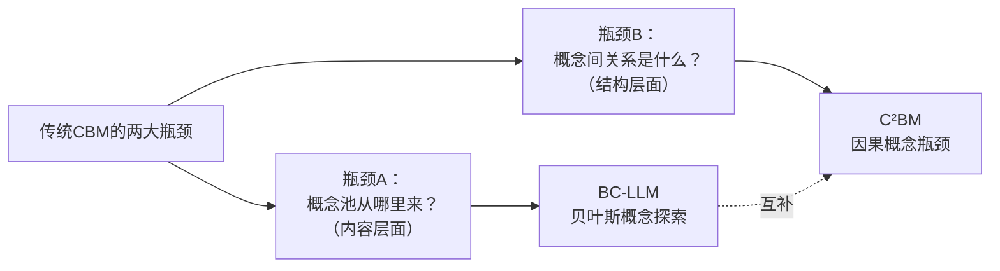
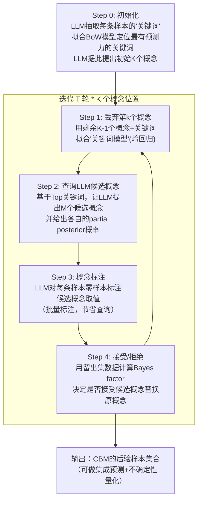
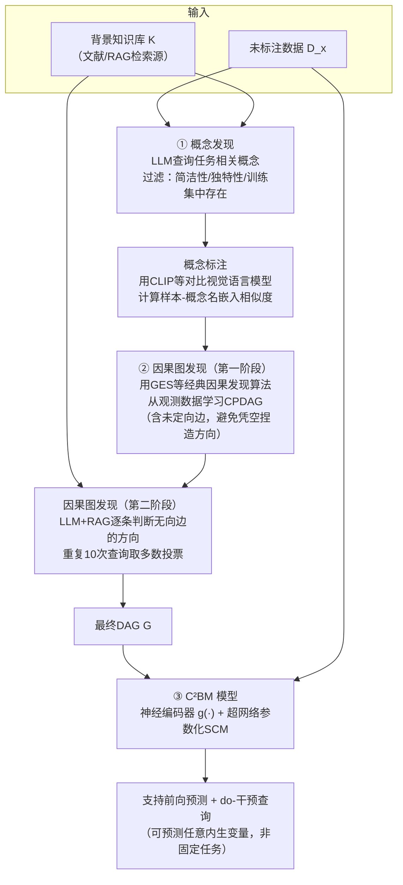
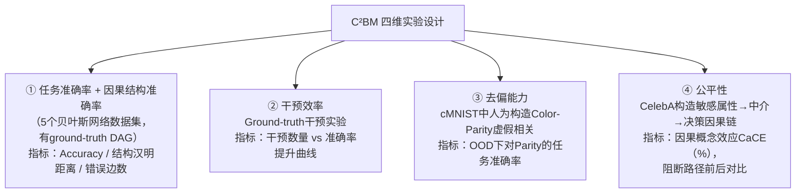
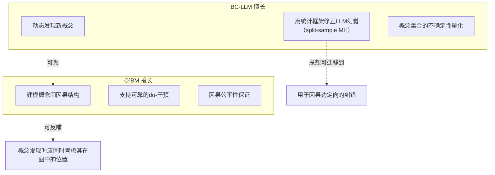

# 基于LLM的概念瓶颈模型（CBM）文献研读与研究方向汇报

> 汇报人：何宁秋
> 日期：2026年9月17日
> 涉及文献：
>
> 1. *Bayesian Concept Bottleneck Models with LLM Priors* (BC-LLM), NeurIPS 2025
> 2. *Causally Reliable Concept Bottleneck Models* (C²BM), NeurIPS 2025

---

## 目录

1. [选题背景与动机](#1-选题背景与动机)
2. [论文精读一：BC-LLM](#2-论文精读一bc-llm)
3. [论文精读二：C²BM](#3-论文精读二c²bm)
4. [两篇论文的对比与综合分析](#4-两篇论文的对比与综合分析)
5. [研究空白识别（Gap Analysis）](#5-研究空白识别gap-analysis)
6. [候选研究方向](#6-候选研究方向)
7. [任务时间计划表](#7-任务时间计划表)
8. [需要导师决策的开放问题](#8-需要导师决策的开放问题)

---

## 1. 选题背景与动机

概念瓶颈模型（Concept Bottleneck Models, CBM）是可解释机器学习的重要范式：模型先将输入映射到一组人类可理解的**概念**（如"是否发烧""是否有蓝色羽毛"），再由一个透明的下游模型（通常是线性/逻辑回归）由概念预测最终标签。这种"先概念、后预测"的两阶段结构使得人类可以审查、干预中间概念，从而提升模型在高风险场景（医疗、金融）中的可信度。

但传统CBM长期存在两个核心瓶颈：

- **瓶颈A：概念从哪里来？** 概念池通常需要人工预先指定并标注，成本高、覆盖不全，且难以适应概念空间理论上无限的场景（如患者笔记中可细化出无数种"物质使用"相关概念）。
- **瓶颈B：概念之间是什么关系？** 标准CBM假设所有概念相互独立，且都是最终预测目标的**直接**原因（bipartite结构），这与真实世界的因果机制往往不符，可能导致误导性解释、虚假相关无法剔除、干预效果传播失效等问题。

本次汇报选取的两篇NeurIPS 2025论文分别针对这两个瓶颈，都采用了"用LLM提出假设、用统计/因果框架校验假设"的思路，具有很强的互补性和可组合的研究空间。

---

## 2. 论文精读一：BC-LLM

### 2.1 问题定义

标准CBM训练流程：预定义候选概念集合 → 用LLM/人工标注每个概念的取值 → 拟合线性模型选择稀疏子集。

**核心矛盾**：候选池要"全"就要标注海量候选概念（成本爆炸，通常需要几百上千个），候选池要"省"就可能漏掉关键概念（导致模型不准确甚至误导用户）。

论文给出的CBM数学形式（Logistic Regression版本）：

$$
p(Y=1 \mid X=x, \boldsymbol{\theta}, \mathbf{c}) = \sigma\!\left(\sum_{k=1}^{K}\theta_k \phi_{c_k}(x) + \theta_0\right)
$$

其中 $\mathbf{c} = (c_1,\dots,c_K)$ 是选中的 $K$ 个概念（"支持集"），$\phi_c(x)$ 是概念 $c$ 在输入 $x$ 上的取值函数。

### 2.2 方法核心：把LLM嵌入贝叶斯变量选择框架

作者将"寻找最优概念集合"问题类比为高维稀疏变量选择问题，通过 **Metropolis-within-Gibbs** 采样后验分布 $p(\mathbf{c}\mid y, X)$。

**关键设计动机**：作者先摆出两个"直觉方案"并指出其失败模式，从而引出自己的方法——这是本文方法论部分最值得学习的论证结构。

| 方案 | 做法 | 问题 |
|---|---|---|
| Update 1：用LLM"先验"提议 | 不给LLM看数据，只让它凭知识提概念 | 提议质量差，接受率低，采样效率极低 |
| Update 2：用LLM"后验"提议 | 把全部数据喂给LLM做ICL式提议 | ICL并非严格贝叶斯推断（Falck et al. 2024已证明），且MH接受率恒为1，无法用数据纠错，不保证收敛 |
| **BC-LLM：Split-sample partial posterior** | 用一部分数据 $S$ 让LLM提议，用剩余数据 $S^c$ 计算接受概率 | 兼顾提议效率与可纠错性 |

**Split-sample Metropolis 更新（核心算法）**：
$$
\alpha = \min\left\{\frac{p(y_{S^c}\mid y_S, (\mathbf{c}_{-k},\check{c}), X)}{p(y_{S^c}\mid y_S, \mathbf{c}, X)},\; 1\right\}
$$

即：LLM在子集 $S$ 上提议候选概念 $\check{c}$（相当于从"部分后验" $p(C_k\mid \mathbf{c}_{-k}, y_S, X)$ 采样），再用留出集 $S^c$ 的似然比决定是否接受——本质上是频率派"样本分裂"思想在贝叶斯框架下的类比。

为进一步降低查询成本，扩展为 **Multiple-try Metropolis-Hastings**（一次提议 $M$ 个候选，批量标注，按后验概率加权抽样后再做accept/reject）。

### 2.3 完整流程（Step 0 - Step 4 迭代）

### 2.4 理论贡献

- **Proposition H.1**：若LLM提议分布恰好等于真实的partial posterior，则该MCMC链的平稳分布就是目标后验 $p(\mathbf{c}\mid y, X)$。
- **Theorem 3.1（更现实的情形）**：即使LLM的partial posterior与真实先验不一致（现实中几乎必然），只要满足一组正则条件（尤其是**Assumption G.1(vii)**：LLM在任意条件下都有非零概率 $\eta$ 提议到"最优"概念之一），该方法仍能证明：

$$
\inf\{\pi(C^*): \pi \in \Pi_n\} \to 1 \quad \text{（依概率，随样本量 } n\to\infty\text{）}
$$

即无论LLM多么不完美，只要它偶尔能"蒙对"最优概念，数据量足够大时该方法就能收敛到真实最优概念集合 $C^*$。

**证明思路简述**：把链看作网络上的流，用谱方法（矩阵算子范数）控制"从正确概念集合逃逸"的概率上界，同时用集中不等式（Talagrand比较不等式）控制经验似然与总体似然的偏差 $O(n^{-\epsilon'})$，最终证明逃逸概率随 $n$ 指数衰减。

### 2.5 实验设计逻辑

| 实验 | 验证什么 |
|---|---|
| CUB鸟类图像分类（37个家族任务） | 图像模态下的准确率、OOD鲁棒性（对未见过的鸟种分类时的熵/不确定性） |
| MIMIC临床笔记模拟数据（真实标签已知） | 概念召回率/精确率的客观评估（因为ground-truth概念已知） |
| ZSFG医院真实再入院数据 | 真实高风险场景下的实用性 + **5位临床医生打分**评估概念的临床相关性 |
| 消融：换LLM（GPT-4o-mini→Claude 3.5 Haiku→Command-R） | 方法对LLM选择的鲁棒性 |
| 消融：Prompt详略程度 | 方法对prompt工程的敏感度 |
| 扩展：K=100，200类全分类 | 方法在概念数量较大时的可扩展性边界 |

**对照组设置的精妙之处**：每一个baseline都精确对应related work中批判的一条技术路线（人工标注CBM、一次性LLM生成CBM、boosting式迭代CBM），使得实验结果直接反驳了这些路线的局限性。

### 2.6 局限性（原文Discussion + 个人判断）

- 官方声明：K通常不超过20（更多概念可解释性下降），未来可探索mini-batching加速。
- 个人补充：
  1. Assumption G.1(vii) 假设LLM"总有非零概率蒙对"，但没有讨论当LLM在某个专业领域**先验知识为零或系统性错误**时（比如小众语言的临床笔记），该假设可能不成立，收敛保证会失效。
  2. 概念之间被假设为通过简单线性求和进入预测模型，没有考虑概念间的因果/统计依赖关系——**这正是C²BM试图解决的问题**。

---

## 3. 论文精读二：C²BM

### 3.1 问题定义

标准CBM（含CEM等扩展）的解码器都基于"bipartite假设"：

$$
Y = f(V_1, V_2, \dots, V_C)
$$

即所有概念都被视为任务的**直接**原因、且彼此独立。作者指出这会导致：
- 误导性解释（如"咳嗽"和"吸烟"同时被视为肺癌的直接原因，暗示"少咳嗽=降低患癌风险"）
- 无法建模概念间天然的共现关系（如"吸烟"和"起火"）
- 干预一个概念时，改进无法传播到与之因果相关的下游概念
- 无法支撑真正的可靠公平性约束（因为敏感属性可能通过未建模的路径泄露影响）

作者提出新定义：

> **因果可靠性（Causal Reliability）**：模型 $\mathcal{M}$ 的决策过程结构与目标现象 $T$ 背后的真实因果机制一致，则称 $\mathcal{M}$ 对 $T$ 是因果可靠的。

并明确指出：**因果可靠性 ≠ 语义透明性**（一个模型可以完全展示所有概念权重，但如果这些权重连接方式与真实因果机制不符，依然不是因果可靠的）。

### 3.2 方法核心：结构因果模型（SCM）形式化的"因果瓶颈"

标准SCM定义：$\langle V, U, F, P(U)\rangle$，其中每个内生变量满足 $V_i = f_i(\text{PA}_i, U_i)$。

C²BM 是神经架构 $\langle g, \mathcal{M}_\Theta \rangle$：
- $g(\cdot)$：神经编码器，从原始输入 $X$ 预测外生变量的分布 $P(U\mid X)$
- $\mathcal{M}_\Theta$：参数化SCM，结构由给定的DAG $\mathbf{G}$ 决定，参数 $\Theta$ 由超网络（hypernetwork）根据外生变量自适应预测

**结构方程（线性形式，兼顾可解释性）**：

$$
V_i = \sum_{V_j \in \text{PA}_i} [\boldsymbol{\theta}_{f_i}]_j \, V_j
$$

**超网络自适应参数化（兼顾非线性表达力）**：

$$
\boldsymbol{\theta}_{f_i} = \mathbf{r}_i(U_i) = \mathbf{r}_i(g(X)_i)
$$

即：结构方程本身是线性的（保证解释性——"每个概念的值是其父节点的加权线性组合"），但权重本身由一个独立的超网络根据每个样本的具体情况自适应生成（保证表达力——可以局部逼近任意非线性关系，如用分段线性近似 $V_2=e^{V_1}$）。

**训练目标**（最大化对数似然）：

$$
\phi^* = \arg\max_\phi \sum_{\mathcal{D}} \sum_{i=1}^{C} \log P(V_i \mid \text{PA}_i, U_i; \mathbf{r}(\mathcal{E}, U)_i)
$$

### 3.3 完整自动化流水线

### 3.4 理论贡献

**Theorem D.1（通用逼近器）**：无论底层因果图 $\mathbf{G}$ 结构如何，只要外生编码器 $g(\cdot)$ 和超网络 $\mathbf{r}_i(\cdot)$ 是通用逼近器，则 C²BM 整体也是通用逼近器。

**证明思路**：按DAG的拓扑序递归证明——根节点直接由 $g,\text{MLP}$ 复合逼近；单父节点情况下线性乘积仍保留逼近能力；多父节点可通过权重置零退化为单父情况；层层递归即可覆盖整个图。

**意义**：消除了"强加因果结构会牺牲表达力"的顾虑——理论上因果结构本身不是准确率的瓶颈。

### 3.5 实验设计逻辑（四维验证体系）

不是简单的"准确率对比"，而是围绕因果性能带来的四种独特收益分别设计实验：

关键结果摘要：
- 准确率：与OpaqNN、CEM等表达力更强的黑盒模型相当，同时因果结构准确率（结构汉明距离）大幅优于flat CBM
- 公平性：C²BM是唯一能把敏感属性对决策的因果效应（CaCE）**完全清零**（0.0%）的方法，因为它能通过干预"物理阻断"因果路径，而其他baseline的概念都直连任务，干预无法完全切断影响

### 3.6 局限性（原文Discussion + 个人判断）

- 官方声明：依赖高质量背景知识库；因果结构学习算法本身在大规模变量集上有可扩展性瓶颈；编码器的OOD泛化能力仍是SCM可靠性的上限。
- 个人补充：
  1. 因果图发现的"两阶段"设计（GES给候选边 → LLM定方向）本质上**完全信任LLM的定向判断**，只做多数投票，没有像BC-LLM那样引入"用留出数据校验LLM判断"的统计纠错机制——如果LLM在某个方向判断上系统性错误（如背景知识过时/存在偏见），没有数据层面的把关。
  2. 概念发现阶段直接复用Oikarinen et al. (2023)的label-free CBM方法，属于"拿来主义"，本文并未在概念发现的完整性/无限性问题上做任何改进——**这正是BC-LLM试图解决的问题**。

---

## 4. 两篇论文的对比与综合分析

### 4.1 核心维度对比

| 维度 | BC-LLM | C²BM |
|---|---|---|
| 解决的CBM瓶颈 | 概念**发现**（内容层面，瓶颈A） | 概念**结构**（关系层面，瓶颈B） |
| LLM的角色 | 概念提议器 + 隐式先验，嵌入贝叶斯MCMC框架被数据纠错 | 概念发现器（沿用已有方法）+ 因果边定向器（多数投票，无数据纠错） |
| 概念间关系假设 | 独立，线性相加进入LR模型 | 结构化DAG，非独立，超网络自适应线性方程 |
| 核心理论保证 | MCMC链渐近收敛到真实概念集合（Thm 3.1） | 无论DAG结构如何都是通用逼近器（Thm D.1） |
| 是否对LLM输出做统计纠错 | ✅ Split-sample Metropolis-Hastings | ❌ 仅重复查询取多数投票 |
| 不确定性量化 | ✅ 后验分布，层次聚类可视化 | ❌ 点估计的因果图，无边级别的置信度 |
| 主要评价指标 | 预测准确率、校准（Brier）、OOD熵、概念精确率/召回率 | 任务准确率、结构汉明距离、干预效率、CaCE公平性指标 |
| 是否有真实人类评估 | ✅ 5位临床医生对概念打分 | ❌ 无 |
| 计算成本控制 | O(nTK) LLM查询 | 因果边定向10次重复查询/边 |

### 4.2 互补性图示

### 4.3 综合判断

两篇论文的方法论内核高度相似——**都不直接信任LLM的输出，而是把LLM嵌入一个有形式化保证的统计/因果框架里，用数据去验证、修正LLM的假设**。这是当前"LLM赋能可解释AI"方向的一个重要范式，但两篇论文在"用什么框架去校验LLM"这一点上走了不同的路：BC-LLM用的是贝叶斯MCMC的accept/reject机制，C²BM用的是"经典因果发现算法+LLM辅助定向"的两阶段流水线，且**校验的严格程度不对等**——前者有理论收敛保证，后者停留在工程层面的多数投票。

这个不对等，正是切入自己研究工作的一个自然入口（详见第5、6节）。

---

## 5. 研究空白识别（Gap Analysis）

| 编号 | 现状 | 问题所在 | 可能的解决方向 |
|---|---|---|---|
| Gap-1 | BC-LLM假设概念间独立，C²BM假设概念集合已给定 | 概念发现与因果结构学习是**割裂**的两个阶段，实际上新发现的概念可能改变已有的因果图（如引入混杂因子） | 联合贝叶斯推断框架，让概念提议和因果边提议共享同一个MCMC链 |
| Gap-2 | C²BM的LLM边定向仅靠重复查询投票，无数据纠错机制 | 当LLM因果判断系统性错误（背景知识过时/有偏）时，多数投票无法发现和修正 | 将BC-LLM的split-sample MH机制迁移到边定向决策上 |
| Gap-3 | BC-LLM对概念集合给出后验分布，C²BM的因果图是点估计 | 因果图的不确定性没有被建模，高风险场景下（临床）"过度自信地给出一个可能错的图"是危险的 | 对因果图的边（存在性/方向）也维护后验分布 |
| Gap-4 | C²BM证明"干预可完全阻断敏感属性路径"，但前提是因果图完整 | 若概念发现（这一步骤本身承认不完整）遗漏了真实存在的中介变量，公平性保证可能被绕过而不自知 | 构造"隐藏中介变量"的实验，检验现有公平性保证在概念不完整时的脆弱性 |
| Gap-5 | 两套方法各自独立控制LLM查询预算 | 若真的联合两个框架，查询成本可能翻倍，缺乏共享查询设计 | 设计一次查询同时获取"概念合理性"和"因果关系判断"的联合prompt |

---

## 6. 候选研究方向

| 方向 | 核心Idea | Novelty来源 | 大致工作量 | 主要依赖资源 | 潜在风险 |
|---|---|---|---|---|---|
| **方向1**：概念发现与因果结构联合推断 | 设计一个联合MCMC链，每步既可能提议新概念也可能提议边调整，理论上证明收敛到 $(C^*, G^*)$ | 理论创新度最高，是对两篇论文理论部分的自然延伸 | 大（需要重新推导收敛证明+搭建复杂实验） | 较强的理论功底 + 中等算力 | 理论证明可能遇到耦合项难以解耦的困难，风险最高 |
| **方向2**：Split-sample机制迁移到因果边定向 | 把BC-LLM的split-sample MH更新直接用于C²BM的边方向决策，给出类似收敛保证 | 方法论嫁接明确，novelty聚焦但清晰 | 中（现有两套代码可复用，主要是新算法+对应理论） | 中等算力，两篇论文的开源代码 | 若收敛证明难以完整给出，可退化为纯实证工作 |
| **方向3**：因果图的贝叶斯不确定性量化（可考虑） | 对DAG的每条边维护后验概率，支持"如实告知不确定性"，尤其面向临床场景 | 补足C²BM未覆盖的不确定性量化空白 | 中偏大（需要设计边级别的后验采样方案） | 需要有ground-truth DAG的数据集（贝叶斯网络仓库已有） | 后验采样在图空间上的设计和推理成本可能较高 |
| **方向4**：概念不完整性对因果公平性的影响（批判/实证型） | 人为隐藏CelebA中真实存在的中介概念，检验C²BM式的干预公平性保证是否失效 | 揭示现有方法的脆弱边界，实证驱动，容易讲出故事 | 小-中（主要是实验设计，理论要求较低） | 复用C²BM开源代码+CelebA数据集 | novelty相对方法性工作偏弱，但故事性强，适合作为切入/练手论文 |
| **方向5**：LLM查询预算的联合优化 | 设计共享查询的prompt，一次查询同时服务概念判断和因果关系判断 | 系统/工程角度的贡献，实用性强 | 小-中 | 需要设计和测试prompt，工作量相对可控 | 理论贡献较薄，更适合作为应用型/系统型论文 |

**个人初步倾向**：优先考虑**方向2**（理论落点清晰、复用现有代码基础、工作量可控，适合作为第一篇可发表工作）或**方向4**（写作难度低、故事性强、适合快速产出初步结果）。方向1可作为中长期目标，视方向2/4的进展情况决定是否继续深入。

---

## 7. 任务时间计划表

> 按 **双周** 汇报节奏制定（可根据组会频率调整为单周）。

| 周次 | 阶段 | 具体任务 | 可交付物 |
|---|---|---|---|
| 第1-2周 | 文献巩固 + 方向确定 | 精读BC-LLM与C²BM的附录理论证明部分；跑通两篇论文的开源代码（复现一个小规模实验，如Asia数据集/CUB子集）；与导师讨论候选方向，确定优先级 | 本汇报文档 + 代码复现截图/日志 |
| 第3-4周 | 方向细化 + 初步实验设计 | 针对确定的方向（如方向2或方向4），细化技术路线；若为理论方向，推导核心公式草稿；若为实证方向，设计具体实验（数据构造方式、评估指标） | 技术方案文档 + 实验设计草案 |
| 第5-6周 | Pilot实验 | 在小规模数据集上跑通pilot实验，验证方法的基本可行性（不追求完整结果） | Pilot实验结果 + 遇到的问题清单 |
| 第7-8周 | 主实验 | 扩展到完整数据集规模，跑完整实验矩阵（含必要的消融） | 主实验结果表格/图 |
| 第9-10周 | 补充实验 + 理论完善 | 根据主实验结果补充消融/鲁棒性实验；若涉及理论证明，完成证明的严谨化 | 补充实验结果 + 理论证明草稿（如适用） |
| 第11-12周 | 论文初稿 | 撰写方法部分、实验部分初稿；准备图表 | 论文初稿（Method + Experiments） |
| 第13周+ | 迭代打磨 | 根据导师/内部意见迭代，补充引言/相关工作/讨论部分 | 完整论文初稿 |

> 说明：每个阶段预留约20%的机动时间应对代码调试、数据获取等不可预见问题；具体周次边界会根据前几周实际进展动态调整，每次汇报时更新本表。

---

## 8. 需要导师决策的开放问题

1. **方向优先级**：候选方向2/4是否符合导师对novelty和可行性的预期？是否有课题组内已有的相关数据/代码资源可以复用（如是否已有临床数据可支持类似BC-LLM的场景）？
2. **目标定位**：本工作是奔着某个具体会议/期刊的deadline去（需要明确时间紧迫度），还是先做扎实的探索性研究、视进展再定投稿目标？
3. **理论 vs 实证的侧重**：如果时间/精力有限，是优先保证一个"小而精"的理论贡献（如方向2的收敛性证明），还是优先产出"故事性强"的实证发现（如方向4）？
4. **算力与数据资源**：是否需要申请额外的GPU资源用于因果发现算法（GES等）在较大规模数据集上的实验？是否有医疗/临床相关数据的获取渠道（若后续想复现类似ZSFG医院的场景）？
5. **是否需要pilot实验先行**：在正式投入方向细化之前，是否需要先花1周时间做一个最小可行性验证（如先用小数据集验证split-sample机制迁移到边定向是否在直觉上work），再决定是否深入？

