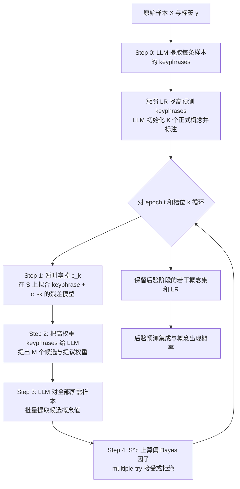

# BC-LLM 与 C²BM：两篇论文的详细过程解读

> 论文 1：*Bayesian Concept Bottleneck Models with LLM Priors*（下文简称 **BC-LLM**）  
> 论文 2：*Causally Reliable Concept Bottleneck Models*（下文简称 **C²BM**）  
> 解读依据：仓库中的两篇论文 PDF、论文附录、作者代码和当前复现实验记录。  
> 文档目标：不只回答“论文做了什么”，还回答“每一步输入输出是什么、为什么这样设计、公式怎样落到代码、实验究竟证明了什么”。

---

## 先看结论：两篇论文分别解决什么问题

标准 Concept Bottleneck Model（CBM）把预测拆为：

\[
X \xrightarrow{\text{概念编码器}} C=(C_1,\ldots,C_K)
\xrightarrow{\text{透明预测头}} Y.
\]

它有两个彼此独立的问题：

1. **应该选哪些概念？** 候选概念太少会漏掉关键信息，太多则标注昂贵、模型不再简洁。
2. **概念之间应该怎样连接？** 标准 CBM 通常默认所有概念彼此独立并直接连到任务 $Y$，这只是预测结构，不一定符合真实因果机制。

两篇论文恰好从两端处理这两个问题：

| 论文 | 核心问题 | 核心解法 | 最重要的输出 |
| --- | --- | --- | --- |
| BC-LLM | 从近乎无限的自然语言概念空间中选什么 | LLM 提议/标注概念，split-sample Metropolis-within-Gibbs 用数据接受或拒绝 | 概念集合的后验样本及其 LR-CBM 集成 |
| C²BM | 已有概念应按什么机制组织 | 数据学习 CPDAG，LLM+RAG 定向，再用超网络参数化的 SCM 沿 DAG 推理 | 一个按因果图传播、可接受概念干预的 CBM |

一句话概括：

- **BC-LLM 主要让“概念选择”更可靠，并量化概念不确定性；它不学习概念间因果图。**
- **C²BM 主要让“概念组织和干预传播”更符合给定因果图；它不对概念集合做 BC-LLM 式贝叶斯搜索。**

因此，两篇论文不是相互替代，而是潜在互补。

---

## 0. 阅读前必须分清的几个概念

### 0.1 Keyphrase、concept、concept value 不是一回事

- **Keyphrase（关键词/短语）**：某个样本中出现的粗粒度描述，例如 `diabetes`、`blue wing`。它只是文本 token 或短语，不一定定义了稳定的特征函数。
- **Concept（概念）**：可以对任意样本求值的明确问题，例如“病历是否表明患者当前或过去吸烟？”
- **Concept value（概念值）**：把概念应用到一个样本后的数值，例如 0、1，或不确定时的 0.5。

BC-LLM 先用 keyphrase 帮助搜索，再把搜索结果写成 concept，最后由 LLM 对每个样本提取 concept value。

### 0.2 “透明”不等于“因果可靠”

若模型清楚展示 `Color -> Parity`，它在结构上是透明的；但颜色并不造成数字奇偶性，因此它并不因果可靠。C²BM 的目标不是只让连接可见，而是让连接与一个真实世界因果模型一致。

### 0.3 观察、干预、反事实是三层不同问题

- 观察：看到 $X=x$ 时，$Y$ 多大？即 $P(Y | X=x)$。
- 干预：主动把 $X$ 设为 $x$ 时，$Y$ 多大？即 $P(Y | do(X=x))$。
- 反事实：对这个已经发生的个体，如果当时把 $X$ 改为 $x'$，结果会怎样？

C²BM 主要展示的是第二层的概念干预能力。论文没有完整解决个体反事实识别问题。

### 0.4 CPDAG 为什么不是完整 DAG

仅靠观察数据，多个 DAG 可能表达完全相同的条件独立关系。这组图构成 Markov 等价类，通常用 CPDAG 表示：

- 有向边：观察数据和结构约束已经可以确定方向；
- 无向边：数据只能确认相邻关系，不能确认因果方向。

C²BM 用 LLM+RAG 处理的正是这些无向边，而不是凭空从所有变量对生成一张图。

---

# 第一部分：BC-LLM 的完整过程

## 1. 问题形式化

给定数据：

\[
D=\{(x_1,y_1),\ldots,(x_n,y_n)\}.
\]

一个自然语言概念 $c$ 对应一个特征提取函数：

\[
\phi_c(x)\in[0,1]
\]

（最简单时为二值 0/1）。模型固定选择 $K$ 个概念：

\[
\mathbf c=(c_1,\ldots,c_K),
\]

并在概念值上拟合 Logistic Regression：

\[
P(Y=1\mid X=x,\theta,\mathbf c)
=\sigma\left(\theta_0+\sum_{k=1}^{K}\theta_k\phi_{c_k}(x)\right).
\]

论文把 $\mathbf c$ 称为模型的 **support（支撑集）**。学习任务不是只估计 LR 系数 $\theta$，而是同时推断“哪 $K$ 个自然语言概念应该进入模型”。

困难在于：传统变量选择只在一个已经列好的有限特征表中选列；BC-LLM 面对的是近似无限的自然语言概念空间，无法预先枚举。

## 2. 贝叶斯变量选择如何迁移到概念选择

目标后验为：

\[
p(\theta,\mathbf c\mid y,X)
=p(\theta\mid \mathbf c,y,X)\,p(\mathbf c\mid y,X).
\]

- 第一项：给定概念集合后，低维 LR 系数的后验；
- 第二项：概念集合本身的后验，是论文重点。

### 2.1 Metropolis-within-Gibbs 外层逻辑

对当前概念集合 $\mathbf c=(c_1,\ldots,c_K)$：

1. 固定其余 $K-1$ 个概念 $\mathbf c_{-k}$；
2. 为第 $k$ 个槽位提议新概念 $\check c_k$；
3. 按 Metropolis-Hastings（MH）概率接受 $\check c_k$，否则保留旧的 $c_k$；
4. 对 $k=1,\ldots,K$ 轮换，再做多个 epoch。

一般 MH 接受率为：

\[
\alpha=\min\left\{
\frac{p((\mathbf c_{-k},\check c_k)\mid y,X)\,
Q(c_k;\mathbf c_{-k})}
{p(\mathbf c\mid y,X)\,
Q(\check c_k;\mathbf c_{-k})},1
\right\}.
\]

其中 $Q$ 是提议分布。只要接受率和提议分布匹配，马尔可夫链就能以目标后验为平稳分布。

### 2.2 为什么不能简单“相信 LLM”

论文先分析两个极端：

**极端 A：LLM 只看任务和已有概念，不看数据。**

可以把 LLM 视作从条件先验 $p(C_k | \mathbf c_{-k})$ 提议。这样数据似然能在 MH 阶段否决坏概念，统计上较干净；但 LLM 不知道数据中真正区分标签的信号，会提出大量无关概念，接受率低且 API 成本高。

**极端 B：LLM 看全部数据并直接“做后验推断”。**

若把提议解释为完整条件后验 $p(C_k | \mathbf c_{-k},y,X)$，MH 接受率会退化为 1。模型再也没有独立数据去否决 LLM 的错误；大数据下，LLM 的上下文和近似推断能力也不可信。

BC-LLM 的关键就是在这两个极端之间做样本切分。

## 3. Split-sample Metropolis：核心中的核心

每次更新第 $k$ 个概念时，把样本随机分成：

\[
S,\quad S^c,
\]

其中 $|S|=\lfloor\omega n\rfloor$，实验通常取 $\omega=0.5$。

- LLM 只根据 $S$ 的摘要提出新概念，可将提议近似解释为 partial posterior：

\[
Q(C_k;\mathbf c_{-k},y_S,X)
\approx p(C_k\mid\mathbf c_{-k},y_S,X).
\]

- 未给 LLM 看的 $S^c$ 用来做接受/拒绝。

单候选 split-sample MH 的接受率简化为：

\[
\alpha=\min\left\{
\frac{p(y_{S^c}\mid y_S,(\mathbf c_{-k},\check c_k),X)}
{p(y_{S^c}\mid y_S,\mathbf c,X)},1
\right\}.
\]

这个比值是 **partial Bayes factor（偏 Bayes 因子）**。直觉是：

- $S$ 负责让 LLM 提出“看起来有希望”的候选；
- $S^c$ 负责检验这个候选能否解释未参与提议的数据；
- 因而 LLM 的领域知识提高搜索效率，独立数据仍保留纠错权。

这不是普通训练/验证划分。划分会在每次概念更新时重新采样，它是 MCMC 转移核的一部分。

## 4. Multiple-try 版本为何更实用

真实实现不是每次只让 LLM 提一个概念，而是一次生成 $M$ 个候选：

\[
\check c_k^{(1)},\ldots,\check c_k^{(M)}.
\]

对每个候选定义权重：

\[
w_m=
p(y_{S^c}\mid y_S,(\mathbf c_{-k},\check c_k^{(m)}),X)
Q(\check c_k^{(m)};\mathbf c_{-k},y_S,X).
\]

先按 $w_m$ 归一化后的概率抽出一个候选 $\check c_k^{(\check m)}$，再做带正向/反向候选集合修正的接受步骤。论文 Algorithm 3 的接受率可理解为：

\[
\alpha=\min\left\{
\frac{Q(c_k;\mathbf c_{-k},y_S,X)\sum_{m=1}^{M}w_m}
{Q(\check c_k^{(\check m)};\mathbf c_{-k},y_S,X)
\sum_{0\le m\le M,m\ne\check m}w_m},1
\right\},
\]

其中 $m=0$ 代表旧概念 $c_k$。

为什么要保留这层看起来复杂的修正？因为“从一批候选中先按权重挑一个”本身改变了提议概率；若不补偿，链的平稳分布会偏离目标后验。

工程收益也很直接：$M$ 个概念可以在一次提示中对同一样本批量标注，比每个候选单独调用 LLM 更省查询。论文推荐 $M=10$。

## 5. 从输入到输出的完整五步



### Step 0：Keyphrase 提取和初始化

1. 对每个 $x_i$，让 LLM 输出若干 keyphrase。
2. 把 keyphrase 做成 BoW/二值特征。
3. 用惩罚 LR 预测 $Y$，找出最有预测力的 keyphrase。
4. 让 LLM 把这些碎片归纳为 $K$ 个明确、可重复求值的 yes/no 概念。
5. LLM 对所有训练样本提取这 $K$ 个概念值，形成初始 CBM。

这里的初始化很重要。纯 MCMC 从差的概念集合起步会混合很慢，因此论文先做一个 greedy warm-start。

### Step 1：拿掉一个概念，再找“当前模型还没解释的信号”

固定 $\mathbf c_{-k}$，在子集 $S$ 上拟合：

\[
\min_{\beta_c,\beta_W}
\frac1{|S|}\sum_{i\in S}
\ell\big(y_i,f(x_i\mid\beta_{c_{-k}},\beta_W)\big)
+\lambda J(\beta_W).
\]

- $c_{-k}$ 的已有概念特征尽量保留；
- keyphrase 特征 $W$ 被正则化；
- 从 keyphrase 系数中挑出模型当前仍未覆盖的正/负信号。

源码还把已有概念的同义词/反义词从 keyphrase 表中 scrub 掉，降低 LLM 重复提出同义概念的概率。

### Step 2：LLM 提出候选概念

提示中包含：

- 当前保留的 $K-1$ 个概念；
- 残差/keyphrase 模型最重要的短语及归一化系数；
- 对概念清晰性、非重复性、不过宽等约束。

LLM 把“acute kidney injury”“chronic kidney disease”等短语综合成可求值的问题，例如“患者是否有肾病史？”。

论文叙述把候选生成和 partial-posterior 权重放在同一步。当前代码实际拆为两次调用：先生成候选，再用专门的 prior prompt 给旧概念与候选概念赋权重。

### Step 3：候选概念标注

对每条样本和每个候选概念，LLM 输出：

- 0：否；
- 1：是；
- 在允许软标注的任务中，可在不确定时输出 0 到 1 的概率。

必须避免把 $y_i$ 暴露给这个标注调用，否则 $\phi_c(x_i)$ 会泄漏标签，透明 LR 的高精度将失去意义。

### Step 4：偏后验估计、抽候选、接受/拒绝

对每个候选，把它与 $\mathbf c_{-k}$ 拼回 $K$ 个概念，估计：

\[
p(y_{S^c}\mid y_S,\mathbf c,X)
=\int p(y_{S^c}\mid\theta,\mathbf c,X)
p(\theta\mid y_S,\mathbf c,X)\,d\theta.
\]

然后按 multiple-try 权重抽一个候选，并按修正后的 $\alpha$ 接受或保留旧概念。

## 6. 用一个小例子走完整个更新

假设当前临床 CBM 有 6 个概念，第 6 个是“患者是否有胸痛”。现在更新第 6 个槽位：

1. 保留前 5 个概念，拿掉“胸痛”。
2. 随机将训练数据一半作为 $S$，另一半作为 $S^c$。
3. 在 $S$ 上拟合“已有 5 个概念 + keyphrase”模型，发现剩余高权重词是 `creatinine`、`kidney injury`、`dialysis`。
4. LLM 提出 10 个候选，例如“是否有肾病史”“是否接受透析”“是否有急性肾损伤”等，并给出相对权重。
5. LLM 对所需样本回答这些概念问题，得到 10 列候选特征。
6. 对每个候选，计算它与前 5 个概念组成的 LR 在 $S^c$ 上的偏后验支持度。
7. 先按 multiple-try 权重选中“是否有肾病史”，再计算接受率。
8. 若接受，则新概念替换“胸痛”；否则第 6 个概念不变。
9. 转到下一个槽位，直到一次 epoch 更新完 6 个槽位。

重要的是：一次替换不是“选验证集 AUC 最大者”这么简单。采样保留了多个相近概念的概率质量，后续才能表达“吸烟史的几种问法在现有数据下无法区分”这类不确定性。

## 7. Laplace 近似到底在近似什么

直接在内外两层循环中对每个候选采样 $\theta$ 会很贵，因此 LR 情形使用 Laplace-like approximation。

设概念设计矩阵为 $\Phi\in\mathbb R^{n\times K}$，LR 系数先验为：

\[
\theta\sim\mathcal N(0,\gamma^2I).
\]

对任意样本子集 $T$，求负对数后验的 MAP：

\[
\theta_{\text{MAP},T}=\arg\min_\theta g_T(\theta),
\]

并在 MAP 附近用二阶 Taylor 展开，Hessian 为 $H_T(\theta_{\text{MAP},T})$。积分后的边际似然近似同时包含：

- MAP 处的拟合项；
- 高斯先验惩罚；
- Hessian 行列式带来的模型容量/不确定性修正。

最后利用：

\[
p(y_{S^c}\mid y_S,\mathbf c,X)
=\frac{p(y\mid\mathbf c,X)}{p(y_S\mid\mathbf c,X)}
\]

得到偏后验预测概率。

直觉上，它不只奖励“拟合好”，还会通过曲率项惩罚只在很窄参数区域内成立的候选。论文附录也明确说明，当前代码采用的是略有不同但同类的 Laplace 计算形式。

## 8. 训练结束后如何预测与解释不确定性

每次 Gibbs 更新后的 $\mathbf c$ 都是一个状态。丢掉 warm-start/burn-in 后，保留最后若干状态：

\[
\mathbf c^{(1)},\ldots,\mathbf c^{(L)}.
\]

每个状态都对应一组概念和一个 LR。对新样本 $x_0$：

1. LLM 提取该状态所需概念值；
2. 对应 LR 给出预测概率；
3. 多个后验状态的概率取平均，形成后验预测集成。

概念 $c$ 的后验出现频率可估计为：

\[
\widehat P(c\text{ 被选择}\mid D)
=\frac1L\sum_{\ell=1}^{L}
\mathbf1\{c\in\mathbf c^{(\ell)}\}.
\]

注意，同义概念可能分散概率质量。因此论文用概念标注列之间的绝对 Pearson 相关大于 0.5 作为“概念匹配”判据，并人工核验，而不是只做字符串精确匹配。

## 9. 理论结果应该怎样准确理解

### 9.1 平稳分布结论

若 LLM 每一轮的提议确实来自某个一致的条件 partial posterior：

\[
Q(C_k;\mathbf c_{-k},y_S,X)
=p(C_k\mid\mathbf c_{-k},y_S,X),
\]

则 split-sample 和 multiple-try split-sample 转移都以 $p(\mathbf c\mid y,X)$ 为平稳分布。

这是一条“提议满足理想条件时”的有限样本 MCMC 正确性结果。

### 9.2 Theorem 3.1 的渐近一致性

论文进一步考虑 LLM 并不是完美 Bayesian engine 的情况。定义：

\[
L(\mathbf c)=\max_\theta
\mathbb E\big[\log p(Y\mid X,\theta,\mathbf c)\big],
\qquad
\mathcal C^*=\arg\max_{\mathbf c}L(\mathbf c).
\]

在 IID、Gaussian 系数先验、最优概念集合有正的性能间隔、候选空间增长受限、设计矩阵非退化等一组正则条件下，所有平稳分布最终把概率集中到 $\mathcal C^*$。

最关键、也最容易被摘要略过的假设是：**对任意当前的 $\mathbf c_{-k}$，LLM 提议机制都必须以至少某个固定正概率覆盖一个可使集合朝最优解前进的真概念。** 如果 LLM 永远不会提出关键概念，接受/拒绝机制无法凭空创造它。

### 9.3 不能过度解读的地方

- 定理是渐近结果，不表示小样本时 LLM 幻觉无影响。
- 有限迭代 $T=5$ 不保证链已经充分混合。
- “严谨不确定性”依赖提议、近似后验、概念标注和 MCMC 收敛等条件。
- 论文推断的是预测意义上最优的概念集合，不等于发现真实世界因果变量。

## 10. 论文实验究竟验证了什么

### 10.1 CUB-Birds 图像分类

- 把 200 个鸟种按 family 分为 37 个族内分类任务；
- 训练/测试 50/50；
- 每个任务 $K=\min(10,\max(4,\text{类别数}))$；
- 故意不告诉 LLM 任务是在分鸟种，只让它为匿名 $Y$ 找概念；
- 对比 Human+CBM、一次性 LLM+CBM、Boosting LLM+CBM、370 个预生成概念方案和 ResNet50。

主要结果（论文 Table 1）：BC-LLM 的平均 accuracy 为 0.680、AUC 为 0.874、Brier 为 0.428；在该小样本设置下也略高于微调最后一层的 ResNet50（accuracy 0.664）。这说明“小样本 + 简洁概念 LR”能避免黑盒过拟合，不代表 BC-LLM 在一般大规模视觉任务上都胜过 ResNet。

OOD 测试使用训练中未出现的鸟种。BC-LLM 的输出熵高于其他 CBM，表示在分布外样本上更不确定；但 ResNet 的熵仍最高。论文的优势主要是：概念级不确定性和 LLM 的文字理由让人知道“模型为什么犹豫”。

### 10.2 MIMIC 临床笔记模拟结局

- 原始笔记来自真实数据，但 $Y$ 由已知的 5 个社会健康决定因素概念经 LR 模拟；
- 数据共 7043 条，训练子集为 100、200、400、800，测试 500；
- $K=6$，$T=5$；
- 因为真概念已知，可以评估 concept precision/recall。

BC-LLM 随样本增加把后验质量收缩到真概念附近；400 个样本时预测性能接近使用真概念的 Oracle CBM。高度相关的吸烟概念保留多种表述，展示的是合理的不可辨识性，而不是算法失败。

### 10.3 真实心衰再入院风险

- 输入包括既有表格模型风险分数 + 从临床笔记提取的 $K=4$ 个概念；
- 1000 位患者训练、500 位患者测试；
- 原表格模型 AUC 0.60，BC-LLM 增强后 AUC 0.64；
- 5 名临床医生盲评特征的临床相关性，BC-LLM 概念平均约 2.5/3，其他方法不高于 2。

该实验支持“LLM 搜索能找到难以从表格手工工程化的临床概念”。但数据含 PHI，不能公开完整复现，因此它更接近真实应用证据而非完全开放 benchmark。

### 10.4 额外实验

- 换用 Command-R 后整体变差，但方法排序大体保持；
- CUB 换 Claude 3.5 Haiku 时 BC-LLM 仍优于两个 LLM-CBM 基线；
- fMoW 从美国图像训练、到中国图像 OOD 测试时，BC-LLM 优于两个 LLM-CBM 基线；
- Imagenette 上 BC-LLM accuracy 0.987，高于对比 LLM-CBM 的 0.902。

这些实验说明方法不只限于临床文本，但大多仍依赖闭源/版本会变化的 LLM，复现时必须记录模型快照、提示、温度与缓存。

## 11. 计算成本与超参数

论文给出的查询复杂度为：

\[
O(nTK),
\]

其中 $T$ 为外层 epoch，$K$ 为概念数。传统预枚举方案为 $O(nW)$，而候选池 $W$ 常需数百或数千。

建议参数及含义：

| 参数 | 论文常用值 | 影响 |
| --- | ---: | --- |
| $\omega$ | 0.5 | 小：候选更多样但不准；大：更贴合训练数据但多样性弱 |
| $M$ | 10 | 大可增加探索，但标注成本和单次提示难度上升 |
| $K$ | 通常不超过 20 | 大会削弱可解释性并增加每轮查询成本 |
| greedy warm-start | 1 epoch | 提升短链的初始质量 |
| $T$ | 实验通常 5 | 小值偏预测；若重视概念不确定性，论文建议可到 10 |
| posterior samples | 实现常取最后 20 个状态 | 更少时概念概率很粗糙 |

## 12. BC-LLM 论文流程与当前源码的对应

| 论文步骤 | 主要源码位置 | 实现要点 |
| --- | --- | --- |
| Step 0 初始化 | 各 `exp_*/sconscript`、`scripts/extract_llm_concepts.py`、`scripts/train_baseline.py` | 初始化在主训练脚本外先完成，再通过 history 和初始概念文件传入 |
| 外层 Gibbs 循环 | `src/bc-llm/src/concept_learner_model.py:112` | epoch 内逐槽位更新；greedy 阶段可一次 hold out 多个槽位 |
| 当前概念标注 | 同文件 `:135`，`src/common.py:196` | 缓存已提取概念，按样本/概念批处理 LLM 调用 |
| 随机切分 $S,S^c$ | `concept_learner_model.py:149` | 分层 50/50 切分，保持类别比例 |
| 残差/keyphrase 模型 | `:184`、`:508` | 已有概念低惩罚，词特征正则；提取高系数 keyphrase |
| 候选生成 | `:197`、`:563` | 最多保留 10 个候选 |
| 候选 prior/partial posterior 权重 | `:229`、`:572` | 由单独的 prior prompt 为旧概念和候选赋权 |
| Multiple-try 接受拒绝 | `:364` | 算正向/反向权重总和，再 Bernoulli 接受 |
| Laplace-like 计算 | `:443` | 以全数据 MAP 与 $S$ 的 MAP/Hessian 组合近似偏后验 |
| 后验集成评估 | `scripts/evaluate_bayesian.py:190` | 取 history 最后若干状态，对预测概率求平均 |

## 13. BC-LLM 最容易误解的八点

1. **LLM 不是最终分类器。** 最终可审计预测头是概念上的 LR；LLM负责搜索和提取概念值。
2. **Bayesian 不是给 LLM 输出套一个置信度。** Bayesian 对象是概念支撑集和 LR 参数。
3. **$S^c$ 不是永久测试集。** 它是每次 MCMC 更新内部的纠错样本；真正测试集仍需完全独立。
4. **接受概率高不等于概念具有因果性。** 它只说明候选有更强的后验预测支持。
5. **后验中出现多个同义概念可能是合理结果。** 数据未必能区分语义接近的概念定义。
6. **LLM 必须有机会提出真概念。** 数据只能拒绝候选，不能补上从未被提议的概念。
7. **短链的 UQ 要谨慎。** $T=5$ 是成本与效果折中，不是标准 MCMC 中充分收敛的证明。
8. **概念提取错误会进入 LR。** MH 可以淘汰预测无用的列，但无法保证保留下来的概念标签语义完全正确。

---

# 第二部分：C²BM 的完整过程

## 14. 它认为标准 CBM 的结构哪里错了

标准 CBM 常写为：

\[
P(Y,V\mid X)=P(Y\mid V)P(V\mid X).
\]

预测头 $Y=f(V_1,\ldots,V_C)$ 隐含了一张二部图：所有概念都是 $Y$ 的直接原因，概念之间没有结构。

例如肺癌预测中，模型同时连接 `Smoker -> Lung cancer` 和 `Cough -> Lung cancer`。这可能让人错误理解为“减少咳嗽能减少肺癌”。咳嗽可能只是下游症状，不应被当成可阻断肺癌的直接原因。

C²BM 的目标是让瓶颈本身是一张 SCM：

\[
V_i=f_i(PA_i,U_i),
\]

其中 $PA_i$ 是内生父变量，$U_i$ 表示图中未显式展开的外生影响。

## 15. 总体流水线分成两个阶段

```mermaid
flowchart TB
    X0[可能无概念标签的数据 D_x] --> CD[概念发现: LLM 生成并过滤]
    BK[背景知识 K] --> CD
    CD --> VL[CLIP/CXR-CLIP 对齐并标注]
    VL --> D[概念标注数据 D=(x,v)]
    D --> GES[GES/BDeu 结构学习]
    GES --> CP[CPDAG]
    BK --> RAG[文档检索 + 重排]
    CP --> OR[逐条无向边询问 LLM: A/B/C]
    RAG --> OR
    OR --> G[DAG G]
    G --> SUB[取目标 Y 的祖先子图并拓扑分层]
    X[输入 X] --> ENC[共享编码器 g]
    ENC --> U[每个节点的外生表示 U_i]
    U --> H[每节点超网络 r_i 生成结构方程权重]
    SUB --> H
    H --> SCM[沿 DAG 从根到目标传播概念概率]
    SCM --> OUT[概念预测、任务预测和干预查询]
```

阶段 A 是 **模型实例化**：找到变量、标签和图。阶段 B 是 **神经模型训练/推理**：在固定图上学习编码器和结构方程参数。

一个重要边界是：如果专家已经提供概念、标签和 DAG，阶段 A 可以完全替换；C²BM 架构本身不绑定 GES、GPT 或 RAG。

## 16. 阶段 A1：概念发现与概念标注

输入是：

- 可能没有概念标注的样本集合 $D_x=\{x_i\}_{i=1}^N$；
- 与任务相关的背景知识库 $K$。

### 16.1 概念发现

沿用 label-free CBM 的思路，让 LLM 列出与目标类别相关、与类别缺失相关，以及目标的上位概念。候选再按以下条件过滤：

- 过长的概念删除；
- 与类别名过于相似的概念删除，避免把答案本身当概念；
- 概念之间过于相似的删除，避免重复；
- 在训练图像中几乎没有对应证据的删除。

论文在 Siim-Pneumothorax 上给出具体阈值：

- 字符长度大于 50 删除；
- CXR-CLIP 余弦相似度对类别名或其他概念大于 0.9 删除；
- 与所有训练图像的最大相似度低于 0.2 删除。

### 16.2 概念标注

用 CLIP 类视觉-语言模型把图像与概念名映射到共享空间，通过相似度得到概念分数，再用 2-means 聚类把分数二值化。

这里必须认识到一个后续影响：GES 学习的图是建立在这些自动概念标签上。如果 CLIP 标签带系统偏差，因果发现看到的是带测量误差的变量，而不是真概念本身。

### 16.3 实验中并非所有数据都真的走了自动概念发现

完整流水线是论文的方法愿景，但大部分 benchmark 已有结构化变量/概念。真正使用“LLM 生成概念 + CXR-CLIP 标注”的主要是没有概念标注的 Siim-Pneumothorax。读实验时不能把所有结果都理解成端到端自动发现概念后的结果。

## 17. 阶段 A2：从标注数据学习因果图

### 17.1 GES 先从数据恢复 Markov 等价类

论文使用 Greedy Equivalence Search（GES），并对离散变量采用 BDeu 分数：

1. 从空图开始；
2. forward phase 贪心加边，只要能提高分数就继续；
3. 到局部最优后进入 backward phase，贪心删边；
4. 输出 CPDAG，而不是强行给所有边定向。

这一步依赖常见的因果发现假设，例如样本近似 IID、观测变量充分覆盖主要共同原因、Markov/faithfulness 类条件。存在未观测混杂时，CPDAG 的因果解释会受限。

### 17.2 LLM+RAG 只处理不确定边

对 CPDAG 中每条无向边 $A-B$，构造三选一问题：

- A：改变 $A$ 会改变 $B$，定向为 $A\to B$；
- B：改变 $B$ 会改变 $A$，定向为 $B\to A$；
- C：没有直接因果关系，删除这条边。

这个设计比“让 LLM 从零画整张图”保守：数据先限定 skeleton/等价类，LLM 只补数据无法识别的方向，并有机会删除伪相关边。

同时也意味着一个限制：**若 GES 漏掉真实边，LLM refinement 通常不会补边；若 GES 已经错误地定向一条边，当前流程也主要不会重新审查它。**

### 17.3 RAG 如何提供证据

论文附录给出的过程是：

1. 根据因果问题分别从 DuckDuckGo 和 arXiv 检索，每个来源取前 10 篇；部分数据集使用本地材料；
2. 文档按 512 token 窗口、128 token 步长切块；
3. LLM 先做 query transformation；
4. 用 `multi-qa-mpnet-base-dot-v1` 嵌入查询和文本块；
5. 按余弦相似度取前 5 个块作为上下文；
6. LLM 输出 A/B/C。

论文称每个问题重复查询 10 次并取众数，以降低随机性。

### 17.4 图后处理

最终神经模型需要 DAG。当前实现会：

- 检查是否仍有无向/双向边；
- 必要时通过图处理保证可用结构；
- 检测并移除环；
- 选定任务节点 $Y$，只保留其祖先子图；
- 按拓扑依赖划为根节点、第 1 层、第 2 层……直到任务节点。

只保留任务祖先非常关键：若某变量不是 $Y$ 的祖先，它不参与此次任务推理，即使原始数据中有标签。

## 18. 阶段 B：C²BM 架构如何逐层计算

### 18.1 数学定义

C²BM 是二元组：

\[
\langle g,M_\Theta\rangle.
\]

- $g$ 建模 $P(U\mid X)$，从原始输入产生每个节点的外生、高维表示 $U_i$；
- $M_\Theta=\langle V,U,F_\Theta,P(U\mid X)\rangle$ 是参数化 SCM；
- 图 $G$ 决定哪些父节点能进入哪个结构方程；
- 超网络 $r_i$ 根据 $U_i$ 为当前样本动态生成结构方程参数。

论文中的结构方程写成：

\[
V_i=\sum_{V_j\in PA_i}[\theta_{f_i}]_jV_j,
\qquad
\theta_{f_i}=r_i(U_i)=r_i(g(X)_i).
\]

表面上是线性方程，但权重随样本 $X$ 改变，所以整体关系可以高度非线性。

### 18.2 实际分类实现比标量公式更具体

若节点 $V_i$ 有 $q_i$ 个类别，源码中传播的是类别概率向量。对非根节点：

1. 拼接所有父节点的概率向量：

\[
p_{PA_i}=\operatorname{concat}(p_j:j\in PA_i).
\]

2. 节点专属 ConceptBlock 从共享编码 $h=g(X)$ 产生 child-specific value embeddings；
3. 超网络 $r_i$ 把这些 embeddings 映射为样本专属权重矩阵：

\[
W_i(X)\in
\mathbb R^{q_i\times\sum_{j\in PA_i}q_j};
\]

4. 计算：

\[
p_i=\operatorname{softmax}\big(W_i(X)p_{PA_i}\big).
\]

对根节点，没有内生父节点，直接由对应 ConceptBlock 从 $g(X)$ 预测其类别概率。

### 18.3 以 Asia 网络中的 Dyspnea 为例

假设父节点为 Bronchitis 和 Either：

\[
p_{\text{Dyspnea}}
=\operatorname{softmax}
\left(W_{\text{Dyspnea}}(X)
[p_{\text{Bronchitis}};p_{\text{Either}}]\right).
\]

推理顺序是：

1. 从 $X$ 预测根节点 Been in Asia、Smoker；
2. 由根节点向下算 Tuberculosis、Lung cancer、Bronchitis；
3. 再算 Either；
4. 最后由 Bronchitis 和 Either 算 Dyspnea。

X-ray anomalies 虽在完整图中，但若它不是 Dyspnea 的祖先，就不会进入这次任务的推理子图。

## 19. 为什么线性结构方程仍然很有表达力

论文的关键技巧是：

- 对父概念的组合保持线性，便于查看每条边的局部权重；
- 用超网络让这些权重依赖当前样本的外生表示，从而拟合非线性关系。

例如 $V_2=e^{V_1}$ 可以在每个局部由 $V_2\approx\theta(X)V_1$ 逼近；$\theta$ 随 $X$ 改变。

论文附录进一步证明，只要编码器和超网络/MLP 是 universal approximator，C²BM 无论底层图是什么都可以逼近任意从 $X$ 到内生变量的映射：

- 根节点可直接由 DNN 逼近任意函数；
- 单父节点时，样本自适应权重与父值的乘积仍有充分表达力；
- 多父节点可以把无用父边权重置零；
- 按拓扑顺序递归即可延伸到深层节点。

这个性质既是优点也是理解论文的关键警告：**任务精度高并不能反证图是正确的。** 超网络可能在图错误时仍从 $X$ 中携带足够信息维持预测。这也解释了图腐败实验中任务精度为何相当稳定。

## 20. 训练目标和实际 loss

论文把条件联合分布分解为：

\[
P(V,U,\Theta\mid X,E)
=P(V\mid U;\Theta)
P(\Theta\mid E,U)
P(U\mid X).
\]

在图的 Markov 条件下：

\[
P(V\mid U;\Theta)
=\prod_iP(V_i\mid PA_i,U_i;r(E,U)_i).
\]

因此训练目标是最大化所有标注节点的对数似然：

\[
\phi^*=\arg\max_\phi
\sum_{(x,v)\in D}\sum_{i=1}^{C}
\log P(V_i\mid PA_i,U_i;r(E,U)_i).
\]

分类代码中对应的是任务交叉熵与概念交叉熵的加权和：

\[
\mathcal L=(1-\alpha)\mathcal L_{task}
+\alpha\mathcal L_{concepts}.
\]

附录报告 $\alpha=0.8$，Adam、最多 500 epochs、early stopping patience 30、LeakyReLU；大多数 batch size 为 512，Pneumothorax 和 SCBM 为 128。

训练时还会随机把一部分概念预测替换为真值，再沿下游传播。这种 training-time intervention 使模型习惯上游概念被人为纠正后的输入分布。

## 21. 干预在前向传播中具体发生什么

对概念 $V_k$ 做 $do(V_k=v)$ 时，代码执行：

1. 正常计算到节点 $V_k$；
2. 用 $v$ 的 one-hot 向量覆盖其预测概率；
3. 所有下游节点使用覆盖后的 $p_k$ 继续计算；
4. $V_k$ 的原父节点不再能改变它，因此效果等价于在前向语义中切断入边。

标准 CBM 中各概念平行，纠正一个上游概念不会自动修正其他相关概念。C²BM 中干预会沿 DAG 传播，所以一次上游纠正可能改善多个下游节点和最终任务。

论文强调它**不声称识别真实的结构函数 $f_i$**。它学习的是能近似结构方程输出的神经参数化；作者认为“可信图结构 + 这种数值近似”足以支持概念层干预。这个主张比“恢复真实 SCM”弱，阅读时不能混用。

## 22. 实验的五个问题与正确解读

### 22.1 Task accuracy：因果结构会不会牺牲预测性能

数据包括五个 bnlearn 离散 Bayesian network（Asia、Sachs、Insurance、Alarm、Hailfinder）、cMNIST、CelebA、自定义 CUBC 和 Siim-Pneumothorax。

对比 OpaqueNN、线性/MLP CBM、CEM、SCBM。C²BM 在多数任务上与高表达力模型接近，例如：

- Asia：71.4%；
- Hailfinder：74.1%，高于表中其他模型；
- cMNIST：94.18%；
- Pneumothorax：80.5%。

在删减概念的 Asia/Alarm 强瓶颈设置下，C²BM 仍较有表达力，因为外生表示可通过超网络调节结构方程。这验证的是架构不容易因图约束而丢失精度，不是图被识别正确。

### 22.2 Causal reliability：学到的图是否更接近真图

论文用自定义 Structural Hamming Distance（SHD）和错误边数比较：

- flat CBM 的固定二部图；
- 仅 causal discovery（CD）；
- CD + LLM/RAG refinement。

例如 Sachs 的错误边数从 flat CBM 的 23 条降到 CD 的 17 条，再降到 CD+LLM 的 7 条；Asia 最终为 1 条。说明背景知识定向能改善部分数据集的图恢复。

要注意该 SHD 使用非标准加权代价：漏边、加边、反向、无向与有向之间的转换惩罚不同。因此不能直接把数值与使用标准 SHD 的其他论文横向比较。

### 22.3 Ground-truth intervention：一次纠正能否帮助更多下游变量

测试时把预测概念替换为 ground-truth 概念值，并按真图从浅到深逐层增加干预节点，统计所有非干预节点（含任务）的平均 accuracy。

C²BM 通常用更少干预取得更大下游提升，原因是：

- 上游纠正会传到真实下游；
- 不相关节点之间没有平行的伪连接；
- SCBM 虽建模概念相关性，但相关传播不等于因果传播。

这里所谓“ground-truth intervention”是把节点设成该样本的真实标签，是 causal do-intervention 的一个特殊用例。它与现实中把吸烟状态真的从 1 变 0 并观察长期结果并不完全相同。

### 22.4 Debiasing：模型是否天然 OOD 鲁棒

biased cMNIST 训练时奇数全为绿色，测试时反转为偶数全为绿色。所有模型的视觉编码器都学到 shortcut，**未干预时包括 C²BM 在内都不能自然外推成功**。

C²BM 的优势在干预后出现：LLM refinement 删除 Color-Parity 伪边；当把 Number 概念纠正为真值后，信息沿正确路径到 Parity，准确率约达 90%。

因此实验结论应写为“因果瓶颈使人工概念纠正更有效并隔离伪路径”，而不是“C²BM 单独解决了 OOD 泛化”。

### 22.5 Fairness：能否通过阻断中介路径消除敏感属性影响

定制 CelebA 中：

- Attractive 是敏感属性；
- Qualified 是受偏见影响的中介；
- Should be Hired 是任务。

先计算 Attractive 对 Should be Hired 的 Causal Concept Effect（CaCE），再固定 Qualified 以阻断唯一因果路径。C²BM 的 CaCE 从 25.1% 变为 0.0%；其他平坦 CBM 仍有残余影响，因为它们保留了所有概念到任务的直接连接。

该实验展示的是“已知敏感路径并能选择正确中介时，结构化瓶颈可执行路径阻断”。它不自动决定什么公平标准是合适的，也不保证真实数据中的未观测偏见被消除。

## 23. 消融实验告诉我们的额外信息

- GES 在论文比较的 PC、GRaSP 等方法中整体较合适，但不同数据集表现仍有差异；
- LLM 类型和 RAG 来源会改变图方向质量，背景材料并非越多越好；
- 样本量增加通常改善图恢复，但观察数据本身仍有 Markov 等价限制；
- 大幅随机翻转、添加、删除边时，任务 accuracy 下降不大；
- 把图逐渐压平为标准 CBM，任务 accuracy 也相对稳定。

最后两点非常重要：C²BM 的预测表达力对图错误有鲁棒性，但也意味着**只看预测精度无法审计因果图**。必须单独评估结构、干预和路径效应。

## 24. C²BM 论文流程与当前源码的对应

| 论文模块 | 主要源码位置 | 实现要点 |
| --- | --- | --- |
| 总流水线 | `src/causally-reliable-cbm/main.py` | 数据加载 → 图加载/发现 → LLM completion → 图修复 → 训练 → 干预测试 |
| GES/PC/GRaSP | `src/causal_discovery/causal_discovery_block.py` | GES 默认用 causal-learn 和 `local_score_BDeu` |
| LLM 定向 | `src/completion/graph_completion.py` | 只枚举 CPDAG 中以 `-1/-1` 表示的无向边，输出 A/B/C |
| RAG | `src/completion/context_generator.py` | 检索、切块、query expansion、embedding 排序 |
| 图清理/分层 | `src/utils.py:97` 以后 | 找父节点、任务祖先、拓扑层、干预策略、去环 |
| C²BM 核心前向 | `src/models/c2bm.py` | 根节点直接预测；非根节点动态生成权重并乘父概率 |
| 节点外生表示 | `src/models/layers/c_encoder.py` | 每个概念/任务一个 ConceptBlock |
| 概念覆盖干预 | `src/models/layers/intervention.py:46` | 将节点预测替换成 ground-truth one-hot |
| 训练与干预测试 | `src/engines/predictor.py` | 随机训练干预、单概念/分层干预、fairness CaCE |
| 损失 | `src/models/c2bm.py:171` | 任务 NLL + 各已预测概念 NLL |
| 自定义 SHD/CaCE | `src/metrics.py` | 图错误加权与概念因果效应计算 |

## 25. 论文描述与当前代码快照的复现差异

以下不是方法原理差异，而是复现时必须记录的版本差异：

1. 论文附录写训练时随机干预概率为 0.25；当前 `sweep_c2bm_*.yaml` 中是 0.8，基础 `engine/predictor.yaml` 默认又是 0.1。
2. 论文附录写概念损失权重 $\alpha=0.8$；C²BM 的基础模型 YAML 默认为 0.5，但论文 sweep 覆盖成 0.8。
3. 论文称每条 LLM 因果问题查询 10 次取众数；当前 `conf/llm/gpt.yaml` 的 `max_tries` 为 1，而 `llm_client.invoke_with_retry()` 才是负责投票的函数。
4. 基础配置是 200 epochs、patience 20；论文 sweep 使用 500 epochs、patience 30。
5. README 中给出的 graph 路径名与仓库实际目录命名有细微差异，复现时应以当前文件树和配置为准。

因此，报告结果时不能只写“按默认配置运行”。应保存 Hydra 完整展开配置、Git commit、LLM 版本、RAG 文档快照和已学习 graph 文件。

## 26. C²BM 最容易误解的十点

1. **C²BM 的“因果”主要来自图结构约束，不是从端到端神经训练中自动涌现。**
2. **它不声称识别真实结构函数。** 超网络只是近似节点输出。
3. **概念发现不是论文所有实验都完整使用的步骤。** 很多数据集已有概念。
4. **LLM 主要处理 CPDAG 的无向边。** 它通常不补 GES 漏边，也不全面复核已定向边。
5. **高 task accuracy 不证明图正确。** universal approximation 和外生表示会遮蔽图错误。
6. **外生表示来自同一个原始 $X$。** 非根节点的超网络仍可从 $X$ 获得丰富残差信息，因此这不是严格的 hard causal bottleneck。
7. **解释的边权是样本相关的。** 不能只看单个样本的一条权重就概括全局因果效应。
8. **ground-truth concept replacement 是特殊干预评估。** 它不等于现实世界所有政策干预。
9. **公平性需要先指定敏感属性、路径和阻断节点。** 模型不自动给出伦理规范。
10. **自动概念标签的测量误差会传入因果发现。** 这在无人工概念标签的数据上尤其关键。

---

# 第三部分：把两篇论文放在一起理解

## 27. 逐维度对比

| 维度 | BC-LLM | C²BM |
| --- | --- | --- |
| 随机对象 | 概念集合 $\mathbf c$ 与 LR 参数 $\theta$ | 神经参数、样本外生表示、结构方程权重 |
| 图结构 | 平坦 CBM；不学习概念间 DAG | 固定/学习出的概念 DAG |
| LLM 角色 | keyphrase、候选概念、候选权重、概念值提取 | 概念生成、文献辅助边定向 |
| 数据纠错机制 | $S^c$ 上偏 Bayes factor 接受/拒绝 | 观察数据先做 GES，LLM 只 refine 无向边 |
| 预测头 | 透明 LR | DAG 上自适应结构方程 |
| 不确定性 | 后验概念集合与后验预测集成 | 常规神经概率；未对图做完整 Bayesian UQ |
| 干预 | 不是主要目标 | 核心目标，沿下游传播 |
| 因果发现 | 无 | 有，但依赖 CD 假设和背景知识 |
| 最强证据 | 概念搜索、校准、小样本与临床可用性 | 图相似度、下游干预、去偏与路径阻断 |
| 最核心风险 | LLM 提议覆盖、短链混合、提取误差 | 图/标签误差、外生通道绕过、因果主张边界 |

## 28. 两篇方法能否直接串起来

概念上可以形成：

\[
\text{BC-LLM 搜索概念}
\rightarrow
\text{对概念值做因果发现}
\rightarrow
\text{C²BM 沿图训练和干预}.
\]

但不能简单把两个仓库首尾相接就称为“Bayesian Causal CBM”，原因有四个：

1. **概念身份对齐**：BC-LLM 后验中同一语义有多种问法，需要先聚类或定义等价类，否则不同后验样本对应不同节点集合。
2. **测量误差**：LLM 提取的概念值不是无噪声观察；普通 GES 没有显式建模这种误差。
3. **图不确定性**：BC-LLM 对概念集合有后验，但 C²BM 通常只接收一张点估计 DAG。严谨组合应联合平均“概念集合 × 图 × 参数”。
4. **干预语义**：预测性概念未必可操作。进入 SCM 前应区分属性、症状、测量值、决策和真正可干预变量。

更合理的研究对象是：

\[
p(\mathbf c,G,\Theta\mid D,K),
\]

而不是先选一组概念再完全忽略选择不确定性。

## 29. 一个可研究的联合框架

可以按以下层次推进：

1. 用 BC-LLM 产生概念后验样本，并把语义近似概念合并为 concept equivalence class；
2. 为每个概念同时保存 LLM 标注概率和标注不确定性，不直接硬阈值化；
3. 对高后验概念子集做能处理测量误差或潜变量的因果发现；
4. 对边方向同时收集数据分数与文献证据，形成边的后验而非单次 A/B/C；
5. 在若干高概率 DAG 上训练 C²BM；
6. 预测和干预时同时平均概念、图和参数不确定性；
7. 分开报告 prediction、graph recovery、intervention calibration 和 human interpretability。

这会真正融合两篇论文各自最强的部分，但计算量和识别假设都明显更复杂。

---

# 第四部分：建议的精读和复现顺序

## 30. 如果你只想先彻底读懂 BC-LLM

按以下顺序：

1. 主文 Sec. 3 开头：先理解 $c$、$\phi_c$、support 和 LR-CBM；
2. Algorithm 1：理解 Metropolis-within-Gibbs 为什么逐槽替换；
3. Sec. 3.1 两个失败极端：理解为什么不能只用 prior 或 full posterior；
4. Algorithm 2：只看单候选 split-sample 接受率；
5. Algorithm 3：再理解 multiple-try 修正；
6. Sec. 3.3 Step 0-4：把数学算法翻译成 LLM 调用；
7. Appendix F：理解 Laplace 近似；
8. Appendix H 和 Theorem 3.1：区分平稳分布与渐近一致性；
9. 最后看 `concept_learner_model.py` 的 `fit()` 和 `_do_acceptance_rejection_step()`。

自测问题：

- 为什么提议数据和验收数据必须分开？
- $Q$ 与偏 Bayes factor 各自负责什么？
- 如果 LLM 永远不提出真概念，理论为什么救不了？
- 为什么 multiple-try 不能只选权重最大的候选？
- 后验概念概率与 LR 系数置信区间分别表示什么？

## 31. 如果你只想先彻底读懂 C²BM

按以下顺序：

1. Sec. 2：区分标准 CBM、SCM 和 causal reliability；
2. Fig. 2：先分清图构建与模型训练两个阶段；
3. Sec. 4.2.2：理解 GES 只得到 CPDAG；
4. Appendix C：理解 RAG 为什么只处理无向边；
5. Sec. 4.3 的 Eq. (3)-(7)：理解动态结构方程和损失；
6. Appendix D 的 Asia 例子：按拓扑顺序手算一次；
7. `models/c2bm.py`：对照概率向量、权重矩阵和 one-hot 干预；
8. 再看 Sec. 5 的五类实验，逐项判断每个实验支持哪条主张。

自测问题：

- 为什么 CPDAG 中会有无向边？
- LLM refinement 能否恢复 GES 没找到的边？
- 根节点与非根节点的预测方式有什么不同？
- 为什么结构方程形式线性但整体模型非线性？
- 为什么错误图下 task accuracy 仍可能很高？
- ground-truth concept intervention 与现实政策干预有什么差别？

## 32. 复现实验时的最低记录清单

### BC-LLM

- 数据划分、随机种子、$K,T,M,\omega$；
- greedy warm-start 和 burn-in 长度；
- LLM 精确模型版本、温度、结构化输出 schema；
- 所有 prompt 文件及实际展开后的 prompt；
- keyphrase 和 concept extraction 缓存；
- 每轮概念集合、提议权重、偏后验、接受率和是否接受；
- 后验集成到底使用最后多少个状态；
- 同义概念匹配规则。

### C²BM

- 概念来源、概念标签来源及阈值；
- CD 算法、分数/检验、样本量；
- CPDAG、每条 LLM 查询的 RAG 文档和 A/B/C 原始回答；
- 投票次数、图去环/删边日志、最终 DAG；
- Hydra 完整展开配置；
- $\alpha$、训练干预概率、噪声、学习率、epoch/patience；
- 干预策略使用真图还是预测图；
- task accuracy、concept accuracy、graph metric 和 intervention metric 分开报告。

---

# 第五部分：结论边界与批判性判断

## 33. 两篇论文最有价值的思想

BC-LLM 最有价值的不是“让 LLM 生成概念”，而是把 LLM 放在 **proposal mechanism** 的位置：它负责高效探索，但是否保留候选由独立数据决定。这个角色分工比直接信任 LLM 更稳健。

C²BM 最有价值的不是“在 CBM 上画一张因果图”，而是让图真正进入前向计算和干预语义：上游节点被覆盖后，下游重新计算，路径阻断才有结构意义。

## 34. 两篇论文最需要保留意见的地方

BC-LLM：

- “Bayesian UQ”在短链、近似提议、近似积分和 LLM 标注误差共同存在时，实际校准程度需要更多诊断；
- 概念是预测性变量，不自动具有因果、稳定或可操作含义；
- API 和模型版本会使精确复现困难。

C²BM：

- 因果可靠性主要建立在最终图接近真实机制的前提上；自动 pipeline 仍可能受观测混杂、标签误差和文献偏差影响；
- 样本自适应外生表示赋予模型极强表达力，也可能让任务信息绕过直观的概念瓶颈；
- 高精度和图腐败鲁棒性不能作为因果结构正确的证据；
- 当前公平实验是精心构造的单路径示例，离开放世界公平审计仍有距离。

## 35. 最终应形成的整体认识

可以把可信概念模型拆成三个独立问题：

\[
\underbrace{\text{概念是否选对}}_{\text{BC-LLM重点}}
\quad+
\underbrace{\text{概念是否量对}}_{\text{两者都依赖但未完全解决}}
\quad+
\underbrace{\text{概念是否连对}}_{\text{C²BM重点}}.
\]

BC-LLM 改进第一项，并对选择不确定性建模；C²BM 改进第三项，并让结构参与干预传播。第二项——概念测量是否稳定、无泄漏、跨域一致——仍是两篇方法共同的薄弱环节，也很可能是后续研究中最值得优先处理的问题。

---

## 附录 A：符号速查

| 符号 | 含义 |
| --- | --- |
| $X,x_i$ | 原始输入随机变量/第 $i$ 个样本 |
| $Y,y_i$ | 任务标签随机变量/观测值 |
| $c$ | 一个自然语言概念定义 |
| $\phi_c(x)$ | 概念 $c$ 在样本 $x$ 上的取值 |
| $\mathbf c$ | BC-LLM 当前的 $K$ 个概念集合 |
| $Q$ | LLM 诱导的概念提议分布 |
| $S,S^c$ | 提议数据子集与验收数据子集 |
| $V_i$ | C²BM 的第 $i$ 个内生概念变量 |
| $U_i$ | 与 $V_i$ 对应的外生高维表示 |
| $PA_i$ | 因果图中 $V_i$ 的父节点 |
| $G,E$ | 因果 DAG 及其边集 |
| $r_i$ | 为节点 $i$ 生成结构方程参数的超网络 |
| $do(V_i=v)$ | 把 $V_i$ 外部设为 $v$，覆盖自然生成机制 |
| CPDAG | 一个 Markov 等价类的部分有向表示 |
| SHD | 图结构差异度；本文 C²BM 使用自定义加权版本 |
| CaCE | 改变概念的 do 值对另一概念/任务期望预测的差 |

## 附录 B：本解读使用的本地材料

- `doc/16679_Bayesian_Concept_Bottlen.pdf`：BC-LLM 论文，32 页。
- `doc/23581_Causally_Reliable_Concep.pdf`：C²BM 论文，41 页。
- `src/bc-llm/`：BC-LLM 作者实现。
- `src/causally-reliable-cbm/`：C²BM 作者实现。
- `doc/论文复现实验进度.md`：当前仓库复现状态，用于区分论文结论与本地已复现范围。
