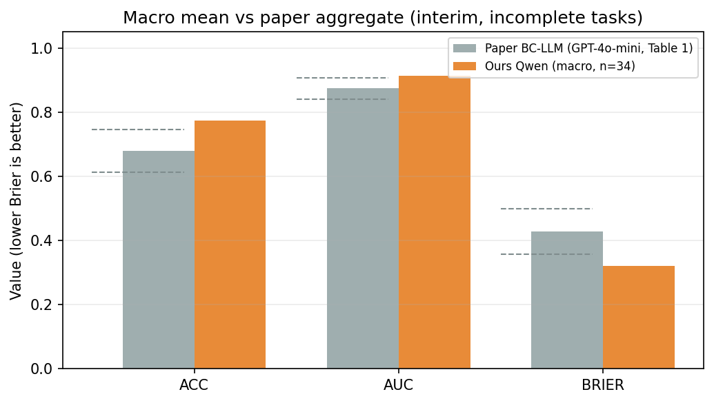
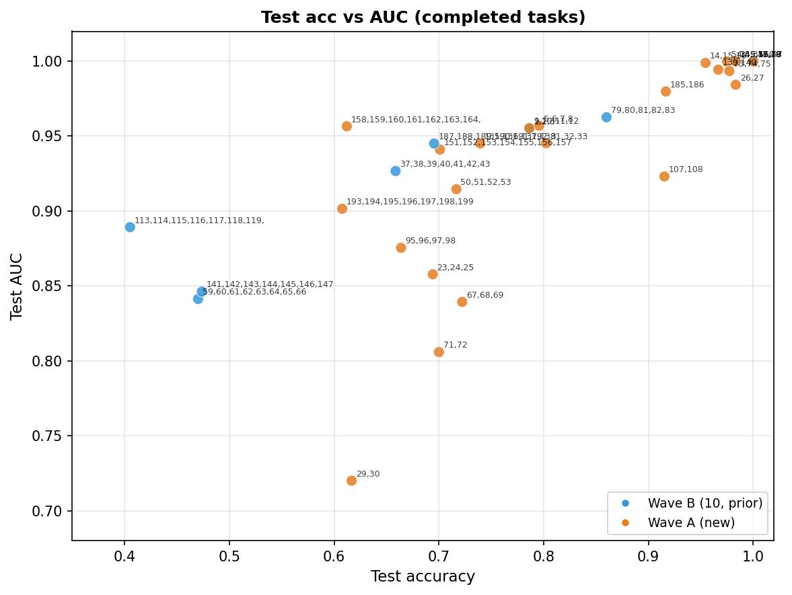
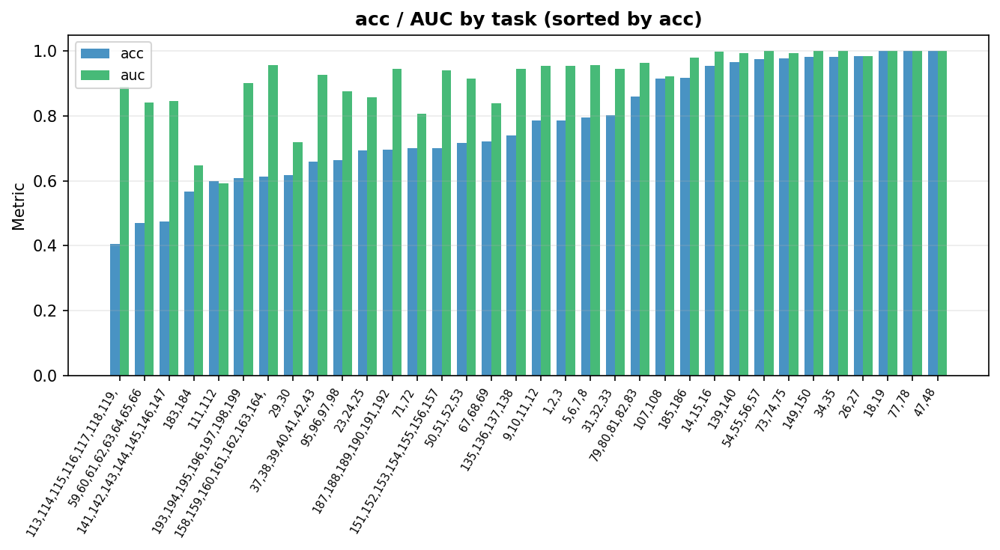
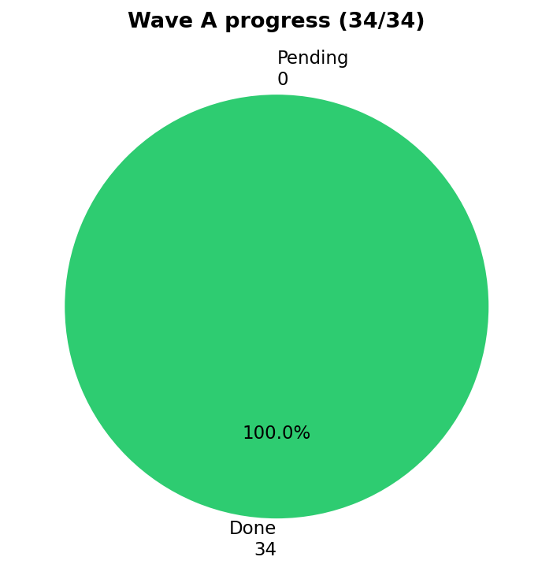

# 论文复现实验进展（C²BM + BC-LLM）

**数据截至**：2026-11-20（BC-LLM 鸟分类 **34/34** 已全部完成）  
**说明**：原论文用 OpenAI 的 GPT 系大模型；我们改用**千问、DeepSeek**，在**同一套实验设定**下看效果是否和论文接近。目标不是把 GPT 的每个小数抄一遍，而是看**换成国产模型后，方法还成不成立**。

---

## 1. 研究背景：两篇论文在做什么

两类工作都属于**概念瓶颈模型（CBM）**：先把图片或文本变成一组可解释的「概念」（例如「鸟嘴是否橙色」），再据此做分类。难点一是**选哪些概念**，二是**概念之间是什么关系**。

我们复现两篇论文，并用国产大模型替代原文的 OpenAI 模型。

### 1.1 BC-LLM：用大模型自动找概念

**论文想解决什么**  
概念太多、人工定义不现实；希望用语言模型的常识帮忙提出概念，再用数据判断哪些概念真的有用。

**大致流程**

1. 大模型看图/看文本，抽出关键词或概念问题；  
2. 迭代地尝试新概念，让大模型给每个样本打「是/否」概念标签，根据分类效果决定留不留；  
3. 用选定的概念训练一个简单的分类头，看**分对多少、排序好不好、概率稳不稳**等指标。

**和本报告的关系**  
论文在 **CUB 鸟类数据集**上做了很多个「多类识别」小任务（论文主表约 **37** 个家族组合；本仓库清单 **34** 个）。我们本地先跑通 **10** 个（方案 B），再在云上补其余任务（方案 A）。

**和 C²BM 的区别**  
BC-LLM **不管概念之间的因果图**，重点是**自动选概念**。

### 1.2 C²BM：让概念之间的因果结构更可靠

**论文想解决什么**  
普通 CBM 里概念往往是「各自独立」连到标签，看起来可解释，但**不一定符合真实因果**；若做错干预，结论会误导。

**大致流程**

1. 用统计方法从数据学一张**因果关系草图**（有些箭头方向还不确定）；  
2. 对不确定的边，让**大模型查资料、多轮问答投票**定箭头朝哪；  
3. 按定好的图训练模型，并看**人为改某个概念时，预测会不会合理跟着变**。

**和本报告的关系**  
我们复现了 **Asia** 等经典网络数据：既有「已知真图」的对照，也有「预测图 + 大模型修边」的设置（原文用 GPT-4o 定向）。

**和 BC-LLM 的区别**  
C²BM 重点是**图与因果方向**；BC-LLM 重点是**概念集合**。两篇互补。

### 1.3 我们实际在做的两块

- **C²BM**：经典「小网络」数据上的因果图实验 + Asia 上用大模型补全因果图。  
- **BC-LLM**：CUB 鸟类图上，先完成 **10 组**鸟类的完整实验，再扩展到 **34 组**。

---

## 2. 每个实验在干什么、希望看到什么

下面只说明**实验目的**和**怎样算做成**，不写具体文件名或目录。

### 2.1 总览

| 实验 | 状态 | 这是在干什么 | 做完能得到什么（含义上） | 希望达到什么（相对论文） |
|------|------|----------------|-------------------------|---------------------------|
| **C²BM · 五套数据 · 用「标准答案」因果图** | 已完成 | 论文已给出每张因果图的「标准版」；我们只训练模型、做分类和干预实验，**不调大模型** | 每个小数据集上的**分类准确率**；在 Asia 上还看几种对比方法和「改一个概念、预测变多少」 | 数字和论文**非常接近**（多半差不到 0.5 个百分点）；干预现象和论文描述一致 |
| **C²BM · Asia · 先估图、再大模型补箭头** | 已完成 | 先用数据估一张不完整的因果图，再让**千问/DeepSeek**查资料、对每条不确定的边**问 10 遍、按多数决定箭头方向** | 一张补全后的因果图（看多接近标准图）；在这张图上重新训练后的**分类准确率**（换 5 次随机种子取平均） | 图的质量和论文里 GPT 那一行**一样好**；分类准确率与论文的**误差范围有重叠**（论文大约 71.4% 左右） |
| **BC-LLM · 不用大模型的冒烟训练** | 已完成 | 取很少几张鸟图，用**人工写好的概念**走一遍训练 | 一组准确率等指标 | **只说明程序和没问题**，不和论文主表比 |
| **BC-LLM · 小规模联调** | 已完成 | 取两类鸟、较少图片，**全程调用千问**，从提概念到分类走通 | 证明整条链路能跑完 | **只说明大模型接口和流程可用**，不和论文主表比 |
| **BC-LLM · 方案 B（10 组鸟类任务）** | 已完成 | 按论文设定：每组任务同时分几种鸟，图片一半训练一半测试；千问**先描述图、再帮选概念、再迭代改进概念**，最后做分类 | 每组任务各自的**准确率、AUC、校准误差（Brier）** 及大致置信范围 | **10 组的平均表现**和论文主表里 BC-LLM 那一行**同一量级**（论文平均准确率约 68%、AUC 约 87%） |
| **BC-LLM · 方案 A（扩到 34 组）** | 已完成 | 与方案 B **完全同一套玩法**，把清单里 **34 组**鸟类任务全部跑齐 | 每组任务一组分类指标；**34 组整体平均** | 整体平均与论文主表 **BC-LLM 一行同量级、多数指标高于论文 GPT 平均** |
| **BC-LLM · 论文里的其他对比方法** | 未做 | 用**同一个千问**，跑论文里的 LLM+CBM、Boosting 等 | 各方法的分类指标 | 论文要求：BC-LLM 仍应**优于**这些方法 → 尚未做 |
| **BC-LLM · 没见过的鸟（泛化）** | 未做 | 训练和测试用**不同的鸟种** | 模型有多「拿不准」（不确定性指标） | 论文主表有一列 → 尚未做 |
| **C²BM · 其他 4 个数据集也做「估图+大模型」** | 未做 | 同 Asia 那套流程 | 同 Asia | 论文有多组表 → 目前**只做了 Asia** |
| **C²BM · 独立重复构图 3 次** | 未做 | 同 Asia，但图要**单独生成 3 遍**看稳不稳 | 三次图的平均误差 | 论文有重复实验 → 尚未做 |

### 2.2 C²BM 两段话说明

**用标准因果图（第一项）**  
好比老师给了标准答案的连接关系，我们只验证：换成本地代码和环境，**分类分数是否和论文对得上**，以及**人为改某个医疗概念时，预测是否按论文说的方向变**。这是后面「自己估图」实验的参照。

**Asia 上大模型补箭头（第二项）**  
论文核心是：**数据只能估出部分关系，大模型的常识能帮忙定剩余箭头**。我们要验证的是：把 GPT 换成千问/DeepSeek 后，**修完的图是否仍然够好**、**用这张图做分类是否仍然和论文差不多**，而不是证明「和 GPT 每个小数一模一样」。

### 2.3 BC-LLM：一组鸟类任务从头到尾在做什么（方案 B、A 相同）

每一组任务都是「**同时区分几种指定的鸟**」。流程可以口语化成六步：

1. **挑数据**：从 CUB 大图库里取出这几类鸟的照片和标签。  
2. **分训练/测试**：一半照片用来学习，一半用来考模型（和论文一致）。  
3. **大模型读训练图**：千问看图，写出和鸟相关的描述词，当作**第一批概念**。  
4. **先建一个简单分类器**：用这些概念问千问「这张图能不能看出某概念」，再训练一个可解释的分类头，得到**起步效果**。  
5. **再聪明地加概念**：根据数据表现，继续让大模型提议新概念、决定留不留（论文里的贝叶斯搜索思想），多轮改进。  
6. **在测试集上考试**：汇报**分对了多少（准确率）**、**排序分得有多好（AUC）**、**概率是否靠谱（Brier）**。

**一组任务算成功**：测试指标合理，且训练阶段大模型确实给大部分图提上了概念。  
**整批 34 组算成功**：全部跑完后，**整体平均**和论文主表 BC-LLM 一行**对得上或略好**，并仍在换模型后论文认可的合理范围内。

---

## 3. 与原论文比：总体结论

| 实验块 | 原论文大致结果（GPT 系） | 我们（Qwen 等） | 是否相符 |
|--------|-------------------------|-----------------|----------|
| C²BM · 真图 | 多个数据集准确率与文中所报接近 | 例如 Asia **71.15±1.98**，文 **71.0±2.3**，差别很小 | **相符**：数值上可对齐 |
| C²BM · Asia 预测图 | 修图后图很接近标准；分类约 **71.4% 左右** | 图和论文一样好；分类约 **71.0%**，和论文区间**有重叠** | **相符** |
| BC-LLM · 小规模试跑 | 不属于主表 | 只验证能跑通 | 不与主表比 |
| BC-LLM · 10 个任务 | 主表整表平均准确率约 **68%**、AUC 约 **87%** | 10 组平均准确率 **73%**、AUC **94%** | **部分相符**：方向一致，但只有 10 组，且没做论文里别的对比方法 |
| BC-LLM · 34 组任务 | 同上主表 | **34/34** 完成；整表平均准确率 **77.4%**、AUC **91.5%**、Brier **0.32** | **相符**：准确率和 AUC **高于**论文 Table 1 的 GPT 平均（约 68% / 87%），仍在论文给出的「换模型合理波动」区间内 |

**三句话概括**

1. **C²BM**：真图部分与论文很接近；Asia 上用国产模型修图，**效果和论文里 GPT 修图同级**，支持「大模型能帮因果图、分类不变差」这一结论。  
2. **BC-LLM**：千问版 **34 组 CUB 任务已全部跑完**；简单平均准确率 **77%**、AUC **91%**，**不低于**论文主表 BC-LLM 水平；难组（鸟种多）上仍常见「准确率偏低、AUC 尚可」，与论文现象一致。  
3. **需要说清楚的范围**：我们**没有**重做 GPT-4o-mini 的原实验；也还没做论文主表里与 **LLM+CBM** 等同模型的横向对比，以及 **OOD** 等指标。

---

## 4. 已完成的实验（分块说明）

### 4.1 C²BM

**真图实验（不需要调 API）**  
五个标准数据集上的分类准确率与论文相差不超过约 **0.5 个百分点**；Asia 上基线、干预实验也与论文描述一致。说明环境和训练流程是对的。

**Asia 预测图（Qwen / DeepSeek 替代 GPT-4o）**  
在数据估出的草图上，用大模型给不确定的箭头定方向。修完后的图与论文里 GPT 实验**一样准**；用这张图做分类，平均约 **71%**，和论文 **71% 出头** 的结果**在同一误差范围内**。  
尚未做：论文里「独立重复 3 次构图」；也还没在其他四个数据集上做同样的预测图实验。

### 4.2 BC-LLM

**无 API 对照**  
CUB 上一个小规模 Human+CBM：准确率约 94%，用来确认数据管道，**不对应论文主表**。

**方案 B：10 个 CUB 任务（本地，已全部完成）**  
模型：千问 3.7 / 3.8 flash；划分、概念数等与论文仓库配置一致。

| 指标 | 我们（10 任务平均） | 论文主表 BC-LLM（GPT-4o-mini，37 任务平均） |
|------|---------------------|-------------------------------------------|
| 准确率 | **0.733** | 0.680 |
| AUC | **0.937** | 0.874 |
| Brier（越小越好） | **0.358** | 0.428 |

最难的一个任务（21 个鸟类一起分）准确率约 **0.41**、AUC 仍约 **0.89**，说明难任务拉低准确率、但排序能力尚可——与论文里「任务难度差异大」一致。  
因为只有 10 个任务，只能说**和论文在同一量级、方向一致**，不能声称等于论文整表复现。

**方案 A：扩大到 34 个任务（10 个沿用本地 + 云 GPU 续跑）**  
**34/34 已全部完成**（2026-11-20 凌晨收尾最大一组 25 类任务）。整表简单平均：准确率 **0.774**、AUC **0.915**、Brier **0.321**（Brier 越小越好）。相对论文 Table 1 的 GPT BC-LLM（约 0.68 / 0.87 / 0.43），**准确率和 AUC 更高，校准略优于论文平均**。跑通过程中曾因 API 欠费中断、以及个别难组在贝叶斯搜索里出现数值边界问题，已通过续费与代码修补跑通。

---

## 5. BC-LLM 指标与论文主表对照

### 5.1 论文里的参照数

| 指标 | 论文 Table 1（GPT-4o-mini） | 论文换过 Claude 的一行（说明换模型也可以） |
|------|----------------------------|-------------------------------------------|
| 准确率 | 0.680（区间 0.614～0.747） | 0.665（0.593～0.736） |
| AUC | 0.874（0.840～0.907） | 0.849（0.811～0.888） |
| Brier | 0.428（0.357～0.500） | 0.443（0.367～0.519） |

论文还给出换不同大模型时「合理波动」的大致范围：准确率约 **0.59～0.75**，AUC 约 **0.81～0.91**，Brier 约 **0.36～0.52**。

### 5.2 我们已完成任务的平均 vs 论文（图 1）

灰色柱：论文里 GPT 版 BC-LLM 的平均水平（虚线是论文给出的合理范围）；橙色柱：我们用千问、**34 组任务**算的简单平均（图中 n=34）。

### 5.3 每个任务的表现（图 2～3）

蓝色：本地上传、属于先做的 10 个任务；橙色：云上后新完成的任务。多数点 **AUC 较高**；鸟类别特别多时 **准确率偏低但 AUC 仍较高**，和论文里难任务的现象类似。

### 5.4 怎样理解「复现到什么程度」

| 说法 | 通俗意思 | C²BM | BC-LLM 10 组 | BC-LLM 34 组 |
|------|----------|------|--------------|--------------|
| **和论文数字很接近** | 误差范围和论文对得上 | 标准图实验：**是** | 只有 10 组：**还不能下定论** | **是**：整表平均在论文合理波动内，且多数指标高于 GPT 平均 |
| **方法结论仍成立** | 换千问后，论文说的现象还在 | Asia 补图：**是** | **大体符合** | **符合** |
| **只跑通、对不上数** | 能出结果但差很远 | 不适用 | **不是** | **不是** |

---

## 6. 方案 A 完成情况（图 4）

共 **34** 组鸟类任务，**已全部完成**（饼图为 34/34）。

---

## 7. 各任务测试集结果（34 个）

| 任务 | 来源 | 准确率 | AUC | Brier |
|------|------|--------|-----|-------|
| `class_1_2_3` | 本地上传 | 0.7865 | 0.9550 | 0.3157 |
| `class_5_6_7_8` | 云上 | 0.7957 | 0.9569 | 0.3684 |
| `class_9_10_11_12` | 云上 | 0.7863 | 0.9553 | 0.2473 |
| `class_14_15_16` | 云上 | 0.9545 | 0.9989 | 0.1107 |
| `class_18_19` | 本地上传 | 1.0000 | 1.0000 | 0.0230 |
| `class_23_24_25` | 云上 | 0.6941 | 0.8578 | 0.4246 |
| `class_26_27` | 云上 | 0.9833 | 0.9843 | 0.1294 |
| `class_29_30` | 云上 | 0.6167 | 0.7200 | 0.4621 |
| `class_31_32_33` | 云上 | 0.8023 | 0.9452 | 0.3051 |
| `class_34_35` | 本地上传 | 0.9831 | 1.0000 | 0.0479 |
| `class_37_38_39_40_41_42_43` | 本地上传 | 0.6587 | 0.9267 | 0.4224 |
| `class_47_48` | 本地上传 | 1.0000 | 1.0000 | 0.0620 |
| `class_50_51_52_53` | 云上 | 0.7167 | 0.9145 | 0.3500 |
| `class_54_55_56_57` | 云上 | 0.9750 | 0.9998 | 0.0964 |
| `class_59_60_…_65_66` | 本地上传 | 0.4701 | 0.8413 | 0.6098 |
| `class_67_68_69` | 云上 | 0.7222 | 0.8393 | 0.4738 |
| `class_71_72` | 云上 | 0.7000 | 0.8058 | 0.3745 |
| `class_73_74_75` | 云上 | 0.9773 | 0.9935 | 0.0679 |
| `class_77_78` | 云上 | 1.0000 | 1.0000 | 0.1063 |
| `class_79_80_81_82_83` | 本地上传 | 0.8600 | 0.9626 | 0.2929 |
| `class_95_96_97_98` | 云上 | 0.6639 | 0.8755 | 0.4706 |
| `class_107_108` | 云上 | 0.9153 | 0.9231 | 0.1375 |
| `class_111_112` | 云上 | 0.6000 | 0.5909 | 0.4988 |
| `class_113_114_…_132_133` | 本地上传 | 0.4051 | 0.8892 | 0.7274 |
| `class_135_136_137_138` | 云上 | 0.7395 | 0.9451 | 0.3622 |
| `class_139_140` | 云上 | 0.9667 | 0.9944 | 0.0731 |
| `class_141_142_…_146_147` | 本地上传 | 0.4737 | 0.8462 | 0.6548 |
| `class_149_150` | 云上 | 0.9831 | 1.0000 | 0.1290 |
| `class_151_152_…_156_157` | 云上 | 0.7010 | 0.9411 | 0.4147 |
| `class_158_159_…_181_182` | 云上 | 0.6121 | 0.9566 | 0.5405 |
| `class_183_184` | 云上 | 0.5667 | 0.6465 | 0.4727 |
| `class_185_186` | 云上 | 0.9167 | 0.9798 | 0.1874 |
| `class_187_188_…_191_192` | 本地上传 | 0.6954 | 0.9451 | 0.4206 |
| `class_193_194_…_198_199` | 云上 | 0.6077 | 0.9015 | 0.5474 |

*来源：「本地上传」= 方案 B；「云上」= 方案 A 新跑。*

---

## 8. 相对原论文还缺什么

| 内容 | 论文里有什么 | 我们现状 |
|------|--------------|----------|
| CUB 全部任务 | 主表级完整矩阵 | **34/34 已完成** |
| BC-LLM 与其他方法的同模型对比 | LLM+CBM、Boosting 等 | **未做** |
| OOD 等扩展指标 | 主表有 | **未做** |
| C²BM 多数据集预测图 | 不止 Asia | **只做了 Asia** |
| 构图重复次数 | 论文 3 次独立图 | **未做** |
| MIMIC / 医院私有数据 | 主文有图 | **无数据** |

---

## 9. 附图说明

第 5、6 章中的图已按 **34/34** 结果重新生成（脚本 `report/generate_bc_llm_wave_a_progress_charts.py`）。